# GETDDO Backend

GETDDO는 응모권을 모아 경품 이벤트에 참여하고 추첨 결과를 확인하는 **이벤트 응모 및 추첨 플랫폼**입니다.

### 목차

1. [프로젝트 개요](#프로젝트-개요)
2. [기술 스택](#기술-스택)
3. [프로젝트 팀 구성 및 역할](#프로젝트-팀-구성-및-역할)
4. [아키텍처와 패키지 구조](#아키텍처와-패키지-구조)
5. [ERD](#erd)
6. [프로젝트 수행 경과](#프로젝트-수행-경과)
7. [실행 방법](#실행-방법)

## 프로젝트 개요

### 서비스 소개와 기획 배경

커머스의 경품 이벤트는 사용자의 참여를 유도하는 동시에 응모권 지급·사용 이력과 추첨 결과에 대한 신뢰가 필요한 기능입니다. GETDDO는 이 과제를 주제로 출석·미션·게임에서 이벤트 참여와 운영자용 백오피스까지 이어지는 서비스를 개발합니다.

사용자가 보는 참여 화면뿐 아니라 중복 요청, 동시 응모, 응모권 반환, 추첨 근거 보존과 실패 복구를 함께 다룹니다. 기획의 기준은 [공용 요구사항](https://github.com/Uplus-GETDDO/getddo-spec/blob/main/00-requirements/README.md)입니다.

### 프로젝트 목표

| 목표 | 확인할 내용 |
| --- | --- |
| 참여형 이벤트 경험 | 활동으로 응모권을 얻고 이벤트 조회·응모·결과 확인으로 이어지는 사용자 흐름 |
| 응모권의 일관성 | 지급·차감·반환·만료 이력과 현재 응모권 상태의 일치 |
| 신뢰할 수 있는 응모·추첨 | 중복 접수·중복 당첨 방지와 후보·가중치·조건·확정 결과 보존 |
| 운영 가능한 서비스 | 관리자 이벤트·경품 관리, 취소 처리, 알림과 실패 재처리 |

### 주요 서비스 흐름

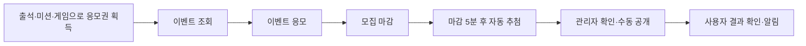

## 기술 스택

| 구분 | 기술 |
| --- | --- |
| 언어 |  |
| 프레임워크 |   |
| 빌드 |  |
| 데이터베이스 |  |
| 캐시 |  |
| 영속성·마이그레이션 |   |
| 객체 매핑 |   |
| API 문서 |   |
| 테스트 |    |
| 실행 환경 |   |
| CI |  |

## 프로젝트 팀 구성 및 역할

### 팀원 소개와 담당 영역

| 팀원 | 담당 영역 | 주요 기능 |
| --- | --- | --- |
| 이경주 | 인프라·공통 기반·사용자 | 실행·배포 환경, 공통 응답·오류·시간·감사 기록, 사용자·역할·멤버십 |
| 석종수 | 어뷰징 차단 기록·추첨 | 지급 전 차단 근거 기록, 후보·가중치 스냅샷, 추첨·당첨 취소·재추첨·결과 공개 |
| 전민규 | 백오피스·알림·게임 | 관리자 운영 기능, 배너·정책 관리, 알림 생성·발송·복구, 게임 검증·보상 자격 |
| 윤태형 | 응모권·미션·출석·응모 | 응모권 지급·차감·반환·만료, 출석·미션 보상, 응모 접수·내역 |
| 박지훈 | 이벤트·경품 관리·이벤트 취소 | 사용자·관리자 이벤트 조회, 이벤트·경품 CRUD, 시작·마감 전환, 취소 연동 |

## 아키텍처와 패키지 구조

### 시스템 아키텍처

[](docs/assets/cloud-architecture.drawio)

### 모듈 의존 관계

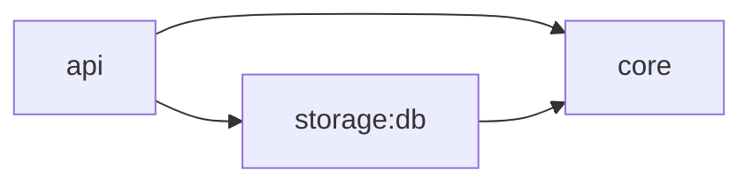

`api`만 실행 가능한 Spring Boot JAR을 만들고, `core`와 `storage:db`는 라이브러리로 함께 실행합니다. `core`는 HTTP DTO와 JPA Entity에 의존하지 않고 Repository 인터페이스로 저장 기능을 사용합니다.

| 모듈 | 역할·사용 이유 |
| --- | --- |
| api | HTTP 요청·입력 검증·사용자 문맥·응답 변환을 업무 규칙과 분리 |
| core | 도메인 모델·업무 규칙·Service·트랜잭션과 Repository 계약을 관리 |
| storage:db | JPA·JDBC 저장 구현, Entity·Mapper와 Flyway 마이그레이션을 관리 |

### 패키지 구조

`<도메인>`은 `user`, `event`, `ticket` 등 기능별 패키지를 뜻합니다.

```text
getddo-be/
├── api/                                         # HTTP 요청·응답과 애플리케이션 실행
│   ├── build.gradle                             # 웹·검증·API 문서 의존성
│   └── src/
│       ├── main/
│       │   ├── java/com/getddo/api/
│       │   │   ├── GetddoBeApplication.java     # Spring Boot 진입점
│       │   │   ├── common/                      # API 공통 처리
│       │   │   │   ├── config/                  # MVC·CORS·OpenAPI 설정
│       │   │   │   ├── context/                 # 사용자 문맥 어노테이션·ArgumentResolver
│       │   │   │   ├── exception/               # 공통 API 오류 코드·전역 예외 처리
│       │   │   │   └── response/                # 공통 응답 형식 ResponseEnvelope
│       │   │   └── <도메인>/
│       │   │       ├── controller/              # 요청을 받아 Service에 위임
│       │   │       ├── dto/request/             # 요청 DTO와 입력 검증
│       │   │       └── dto/response/            # 응답 DTO·from(domain) 변환
│       │   └── resources/                       # application.yaml 등 실행 설정
│       ├── test/                                # DB 없는 API·설정 테스트
│       └── integrationTest/                     # 앱 기동·API·DB 연동 테스트
├── core/                                        # 도메인 모델과 비즈니스 규칙
│   ├── build.gradle                             # Spring Context·트랜잭션 의존성
│   └── src/
│       ├── main/java/com/getddo/core/
│       │   ├── common/                          # 공통 예외·페이지 조회 모델·시각 처리
│       │   └── <도메인>/
│       │       ├── domain/                      # 도메인 객체·상태·비즈니스 규칙
│       │       ├── service/                     # 업무 흐름과 트랜잭션
│       │       ├── repository/                  # 조회·저장 인터페이스
│       │       └── exception/                   # 도메인 오류 코드(ErrorCode 구현)
│       └── test/                                # 도메인 규칙·Service 테스트
├── storage/                                     # 영속성 모듈의 경로 구분
│   └── db/                                      # MySQL 영속성 구현
│       ├── build.gradle                         # JPA·Flyway·MySQL 드라이버 의존성
│       └── src/
│           ├── main/
│           │   ├── java/com/getddo/db/
│           │   │   ├── common/                  # 공통 Entity·JPA Auditing 설정
│           │   │   └── <도메인>/
│           │   │       ├── entity/              # DB 테이블에 대응하는 JPA Entity
│           │   │       ├── repository/          # JpaRepository·core Repository 구현
│           │   │       └── mapper/              # Entity ↔ 도메인 객체 변환
│           │   └── resources/db/migration/      # 도메인별 Flyway SQL
│           ├── test/                            # DB 없는 영속성 관련 테스트
│           ├── integrationTest/                 # 실제 MySQL·마이그레이션 검증
│           └── testFixtures/                    # 공유 Testcontainers 설정
├── .github/                                     # GitHub 협업·자동화 설정
│   ├── pull_request_template.md                 # PR 작성 양식
│   └── workflows/                               # 빌드·테스트·이미지 생성·CD·PR 제목 검사
├── infra/                                       # 인프라 정의·배포 자동화 (Gradle 모듈과 별도)
│   └── scripts/                                 # 서버 배포·설정 조회 스크립트
│       ├── deploy-ssm.py                         # S3 파일 전달·SSM 배포 요청·결과 확인
│       ├── deploy-container.sh                   # 설정·컨테이너 교체와 실패 복구
│       ├── fetch-app-env.py                      # Parameter Store 설정 조회·검증
│       ├── daily-release.py                      # dev CI 확인·main 병합
│       └── publish-release.py                    # 배포 성공 버전 발행
├── docs/                                        # 백엔드 API·DB·결정·작업 기록
├── gradle/wrapper/                              # Gradle 실행 버전 고정
├── compose.yaml                                 # 로컬 앱·MySQL 컨테이너 구성
├── compose.deploy.yaml                          # 서버용 앱 컨테이너 구성
├── Dockerfile                                   # 애플리케이션 이미지 빌드
├── .env.example                                 # 로컬 환경변수 예시
├── build.gradle                                 # 모듈 공통 빌드·테스트 설정
├── settings.gradle                              # 프로젝트 이름·모듈 등록
├── gradlew                                      # macOS·Linux·WSL Gradle 실행
└── gradlew.bat                                  # Windows Gradle 실행
```

## ERD

[](docs/assets/erd-2026-10-16.png)

[ERDCloud에서 확대·이동하며 보기](https://www.erdcloud.com/d/vuDvgmGQcvHf6f6g9) · [원본 이미지](docs/assets/erd-2026-10-16.png)

### 도메인별 ERD

| 도메인 | 테이블 수 | 내용 |
| --- | ---: | --- |
| [사용자](https://github.com/Uplus-GETDDO/getddo-be/wiki/ERD-user) | 1 | 사용자 정보·역할·멤버십 |
| [이벤트·응모](https://github.com/Uplus-GETDDO/getddo-be/wiki/ERD-event) | 5 | 이벤트·경품·응모자·응모 요청·배너 |
| [출석](https://github.com/Uplus-GETDDO/getddo-be/wiki/ERD-attendance) | 5 | 일일·연속 출석과 보상 청구 |
| [미션](https://github.com/Uplus-GETDDO/getddo-be/wiki/ERD-mission) | 10 | 퀴즈·설문·제출·보상 청구 |
| [게임](https://github.com/Uplus-GETDDO/getddo-be/wiki/ERD-game) | 6 | 게임·플레이·통계·보상·플레이 검증 근거 |
| [보상 정책](https://github.com/Uplus-GETDDO/getddo-be/wiki/ERD-reward) | 1 | 출석·미션·게임 보상 정책과 적용 기간 |
| [응모권](https://github.com/Uplus-GETDDO/getddo-be/wiki/ERD-ticket) | 2 | 응모권 한 장의 현재 상태와 처리 이력 |
| [어뷰징 검토](https://github.com/Uplus-GETDDO/getddo-be/wiki/ERD-abuse) | 1 | 응모권 지급 전 차단·탐지 근거 |
| [추첨·발표](https://github.com/Uplus-GETDDO/getddo-be/wiki/ERD-drawing) | 11 | 추첨 실행·후보·결과·확인·공개 버전과 실패 이력 |
| [알림](https://github.com/Uplus-GETDDO/getddo-be/wiki/ERD-notification) | 2 | 알림 생성 작업과 사용자 알림 |
| [감사 로그](https://github.com/Uplus-GETDDO/getddo-be/wiki/ERD-audit) | 1 | 변경 행위와 변경 전후 데이터 |

## 프로젝트 수행 경과

<details>
<summary>인프라·CI/CD</summary>

<!-- 작성 담당: 이경주 -->

#### 요청·데이터 흐름

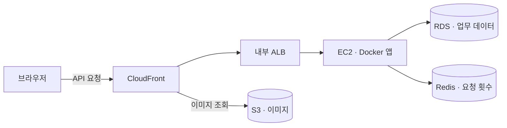

#### CI · 빌드와 이미지 생성

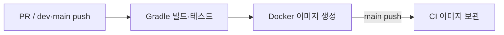

#### 정기 릴리스

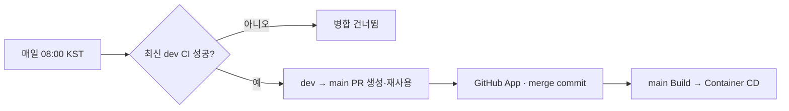

현재 `DAILY_RELEASE_ENABLED=false`이며, 실제 자동 병합·후속 배포는 검증 전입니다. 수동 실행 기본값은 변경 없는 dry-run입니다.

#### CD · 검증한 이미지 배포

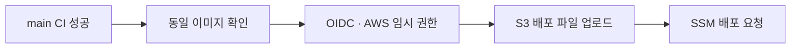

#### 서버 내부 · 설정 전달과 앱 교체

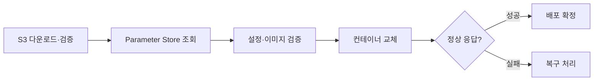

#### 배포 성공 후 버전 발행

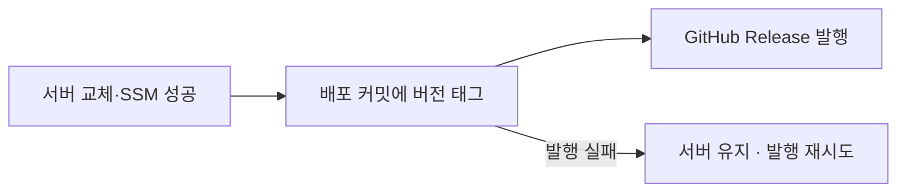

#### 실패 시 처리

| 실패 위치 | 처리 |
| --- | --- |
| dev·main CI | 정기 병합 또는 서버 배포를 진행하지 않음 |
| 설정 조회·이미지 검증 | 기존 앱·설정 유지 |
| 앱 교체·기동 확인 | 이전 설정·이미지 복구 시도 |
| 복구·기록 정리 | 백업·진행 기록 보존, 다음 배포 차단 후 수동 확인 |
| 태그·Release 발행 | 새 앱 유지, 서버를 롤백하지 않고 버전 발행 재시도 |

정상 서버 배포는 3회 확인했습니다. 실서버 실패 주입·자동 롤백과 자동 병합·버전 발행은 아직 검증 전입니다. [배포 이력·실패 대응 상세](https://github.com/Uplus-GETDDO/getddo-be/wiki/CI-CD-Release-Recovery)

#### 설계·기술 선택과 사용 이유

| 선택 | 정리할 내용 |
| --- | --- |
| Docker·Compose | CI 이미지 재사용·YAML 실행 설정 관리. Docker 운영과 서버별 배포 관리 부담을 수용. [대안·트레이드오프 비교](https://github.com/Uplus-GETDDO/getddo-be/wiki/Docker-Compose-Choice) |
| CloudFront·내부 ALB·보안 그룹 | HTTPS 진입, 요청 분산과 접근 경계 |
| RDS·ElastiCache·S3 | 업무 데이터·요청 횟수·이미지의 저장 목적 분리 |
| GitHub Actions·OIDC·SSM | 검증한 이미지 배포와 버전 발행을 분리합니다. 실패 단계별로 유지·복구·재시도를 구분합니다. [정기 릴리스·실패 대응](https://github.com/Uplus-GETDDO/getddo-be/wiki/CI-CD-Release-Recovery) |
| Parameter Store·IAM | 비밀값 보관과 서버별 접근 권한 |
| Terraform·IAM 정책 파일 | 리소스 정의와 변경 검토 방식 |

배포 코드: [CI](.github/workflows/build.yml) · [이미지 생성](.github/workflows/image.yml) · [CD](.github/workflows/cd.yml) · [서버 배포](infra/scripts/deploy-container.sh) · [정기 릴리스](https://github.com/Uplus-GETDDO/getddo-be/blob/6daa51196d24cce298d2824cdeae0ef883fa4408/.github/workflows/daily-release.yml)

</details>

<details>
<summary>공통 기반</summary>

<!-- 작성 담당: 이경주 -->

#### 공통 JSON 응답

성공·실패 모두 `success`, `code`, `message`, `data`로 응답합니다. `data`에는 API별 응답 DTO를 담습니다.

```java
public record ResponseEnvelope<T>(boolean success, String code, String message, T data) {}
```

**성공 응답 · 내 정보 조회 예시**

```json
{
  "success": true,
  "code": "SUCCESS",
  "message": "성공했습니다.",
  "data": {
    "id": "019a0000-0000-7000-8000-000000000001",
    "name": "시연 사용자",
    "role": "USER",
    "status": "ACTIVE",
    "membership": "vip",
    "phoneNum": null,
    "email": null
  }
}
```

**실패 응답 · 미등록 사용자, HTTP 401**

```json
{
  "success": false,
  "code": "USER-002",
  "message": "사용자를 확인할 수 없습니다.",
  "data": null
}
```

데이터 없는 성공 응답은 `ResponseEnvelope.success(null)`을 사용합니다. 오류의 HTTP 상태는 응답 본문과 별도로 지정합니다.

#### 공통 예외 처리

각 도메인은 `ErrorCode`를 구현해 상태·코드·메시지를 정의하고, 업무 오류를 `BusinessException`으로 전달합니다.

```java
throw new BusinessException(UserErrorCode.USER_NOT_FOUND);
```

`GlobalExceptionHandler`가 정의된 HTTP 상태와 `ResponseEnvelope.fail()` 응답으로 변환합니다. Controller마다 try-catch를 반복하지 않으며, 예외 원문·스택 트레이스는 응답에 넣지 않습니다.

#### 사용자 문맥과 Controller 재사용

```java
@GetMapping("/me")
public ResponseEnvelope<UserProfileResponse> getProfile(@CurrentUser User user) {
    return ResponseEnvelope.success(UserProfileResponse.from(userService.getProfile(user)));
}
```

`@CurrentUser`가 시연용 헤더의 형식과 DB 역할·멤버십을 대조해 사용자를 전달합니다. 같은 요청의 사용자 조회 결과를 재사용하고, 필요한 헤더는 Swagger에 자동 표시합니다.

#### 그 밖의 공통 기능

| 공통화한 기능 | 사용 방법·이유 |
| --- | --- |
| 시간 처리 | 주입받은 `TimeProvider`의 `now()`·`businessDate()`·`businessMonth()`로 UTC 시각과 KST 업무일을 계산합니다. 고정 `Clock`으로 날짜 경계 테스트도 재사용합니다. |
| Entity 식별자·감사 시각 | `BaseEntity`를 상속해 UUID v7·생성 시각을 사용하고, 수정 시각이 필요하면 `BaseUpdatableEntity`를 상속합니다. UUID는 `binary(16)`, JPA Auditing 시각은 마이크로초로 맞춥니다. |
| 업무 감사 기록 | 업무 트랜잭션 안에서 `AuditLogService.record(command)`를 호출합니다. `MANDATORY`로 업무와 함께 저장·롤백하고, `AuditLogCommand`는 변경 전후 데이터를 불변 스냅샷으로 보관합니다. |
| CORS 설정 | 허용 origin·메서드·헤더를 환경 설정으로 관리합니다. 공통 필터가 사전 요청과 실제 요청의 CORS 헤더를 처리합니다. |
| MySQL 테스트 기반 | `MySqlTestConfiguration`과 `@ApiIntegrationTest`로 MySQL 8.4 컨테이너·앱·MockMvc 설정을 재사용합니다. |

관련 코드: [응답 형식](api/src/main/java/com/getddo/api/common/response/ResponseEnvelope.java) · [전역 예외 처리](api/src/main/java/com/getddo/api/common/exception/GlobalExceptionHandler.java) · [사용자 문맥](api/src/main/java/com/getddo/api/common/context/CurrentUserArgumentResolver.java) · [시간 처리](core/src/main/java/com/getddo/core/common/time/TimeProvider.java) · [공통 Entity](storage/db/src/main/java/com/getddo/db/common/entity) · [감사 기록](core/src/main/java/com/getddo/core/audit) · [MySQL 테스트 설정](storage/db/src/testFixtures/java/com/getddo/db/support)

</details>

<details>
<summary>사용자</summary>

<!-- 작성 담당: 이경주 -->

담당자 작성 예정입니다.

- **구현 기능·시연 흐름**: 작성 예정
- **설계·기술 선택과 사용 이유**: 작성 예정
- **문제와 해결 과정**: 작성 예정
- **테스트 결과**: 실행일·기준 커밋·명령·성공/실패·검증 범위 작성 예정

기존 참고 자료: [Wiki](https://github.com/Uplus-GETDDO/getddo-be/wiki/Mentoring-Features#user) — 해당 문서의 기준 시점과 현재 구현을 확인한 뒤 작성합니다.

</details>

<details>
<summary>이벤트·경품 관리·이벤트 취소</summary>

<!-- 작성 담당: 박지훈 -->

> 작성 초안 — 담당자 확인 전. 구현 설명은 dev `94ce322b`, 테스트 기록은 아래 별도 기준 커밋을 따릅니다.

**구현 기능·시연 흐름**

- 사용자·관리자 이벤트 목록·상세 조회, 상태·유형 필터와 페이지 조회를 제공합니다. 관리자 검색은 KST 날짜 범위와 모집 기간이 겹치는 이벤트를 조회합니다.
- 이벤트 등록 시 경품을 함께 저장하고, 등수별 경품 종류·당첨 인원·멤버십·응모 조건을 검증합니다. 이벤트·경품 이미지 키는 선택값입니다.
- 시작 전 진행 예정 이벤트의 설정과 경품을 수정합니다. 시작 시각 앞당김을 막고 기존 경품 ID를 유지합니다.
- 시작 전이며 응모 이력이 없는 이벤트는 논리 삭제합니다. 배너는 관리자가 별도로 삭제합니다.
- 이벤트 취소 시 취소 상태·응모권 반환·취소 알림 작업 등록·감사 기록을 연결합니다. 이미 취소된 이벤트의 재요청은 409로 거절합니다.
- 전용 워커가 시작·마감 시각에 모집 상태를 전환합니다. 관리자 응답의 drawScheduledAt은 마감 +5분 자동 추첨 기준이며 실제 결과 공개 시각과 구분합니다.

**설계·기술 선택과 사용 이유**

- 조회는 JDBC로 검색·공개 상태 조건을 표현하고, 변경은 JPA와 이벤트 행 잠금으로 관리합니다.
- 이벤트·경품 저장과 감사 기록, 취소·반환은 업무 트랜잭션으로 묶어 일부만 완료되는 상황을 막습니다.
- 상태 전환은 이벤트별 트랜잭션과 SKIP LOCKED를 사용해 워커 경합과 개별 실패를 분리합니다.

**문제와 해결 과정**

- 잠금 대기 중 시작 시각이 지날 수 있어 잠금 획득 후 시각·상태를 다시 검사하도록 보완했습니다.
- 경품 등수 교환 시 UNIQUE 충돌을 피하도록 같은 트랜잭션에서 임시 등수를 거쳐 변경하고 기존 경품 ID를 보존했습니다.
- 한 이벤트의 감사 저장 실패가 후속 이벤트 전환을 막지 않도록 이벤트별 롤백과 순환 조회를 적용했습니다.

**테스트 결과**

- 2026-10-16 KST, dev `15f2d95c`의 전체 `test build --continue --offline --no-daemon --init-script gradle/test-limits.init.gradle --max-workers=1 --no-parallel` 실행에서 event 패키지 **255개**(단위·MVC·설정 131 / MySQL 통합 124)가 성공했습니다. 실패·오류·건너뜀은 0개입니다.
- 등록·수정·삭제·취소 조건, 잠금 경합, 감사·저장 실패 롤백과 워커 상태 전환을 검증했습니다. 이번 README 재구성에서는 테스트를 재실행하지 않았습니다.
- 집계·원본 자료: [Wiki 테스트 결과](https://github.com/Uplus-GETDDO/getddo-be/wiki/Mentoring-Tests).

상세 구현: [수정](docs/02-api/event-modification.md) · [삭제](docs/02-api/event-deletion.md) · [취소](docs/02-api/event-cancellation.md) · [모집 상태 전환·감사](docs/02-api/event-lifecycle-and-audit.md)

</details>

<details>
<summary>출석</summary>

<!-- 작성 담당: 윤태형 -->

**구현 기능·시연 흐름**

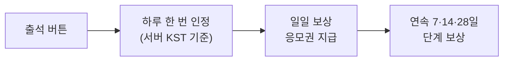

같은 날 다시 눌러도 보상은 한 번만 지급됩니다.

**설계·기술 선택과 사용 이유**

- 출석 기록, 보상 청구, 응모권 지급을 한 번에 확정해서 "출석은 됐는데 보상이 빠지는" 일이 없게 했습니다.
- 같은 날 동시에 눌러도 DB의 중복 방지(사용자 + 날짜)가 한 번만 처리되게 막습니다.

**문제와 해결 과정**

- 연타나 자정 직후 요청에서 보상이 두 번 나갈 수 있었습니다. DB 중복 방지를 마지막 방어선으로 두고, 충돌하면 한 번만 다시 처리해 먼저 확정된 결과를 돌려줍니다.

자세한 표·시퀀스·측정 근거: [Wiki](https://github.com/Uplus-GETDDO/getddo-be/wiki/Mentoring-Domain-Flows#출석)

</details>

<details>
<summary>미션</summary>

<!-- 작성 담당: 윤태형 -->

**구현 기능·시연 흐름**

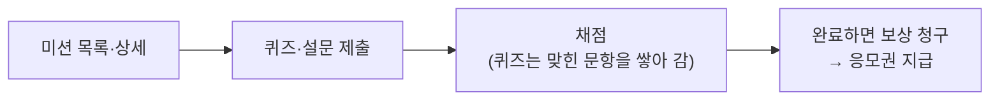

이미 완료한 미션은 다시 제출해도 보상이 더 나오지 않습니다.

**설계·기술 선택과 사용 이유**

- 제출 ID를 DB 기본키로 써서, 같은 요청이 동시에 와도 한 번만 처리됩니다.
- 재전송이 같은 요청인지는 처음 요청의 해시(요약값)로 구분합니다. 지급이 실패하면 제출·답변·청구가 모두 취소됩니다.

**문제와 해결 과정**

- 이미 맞힌 문항의 답은 저장하지 않아서, 재전송 내용을 저장된 답과 비교할 수 없었습니다. 처음 요청의 해시를 저장하도록 했습니다.

자세한 표·시퀀스·측정 근거: [Wiki](https://github.com/Uplus-GETDDO/getddo-be/wiki/Mentoring-Domain-Flows#미션)

</details>

<details>
<summary>응모권</summary>

<!-- 작성 담당: 윤태형 -->

**구현 기능·시연 흐름**

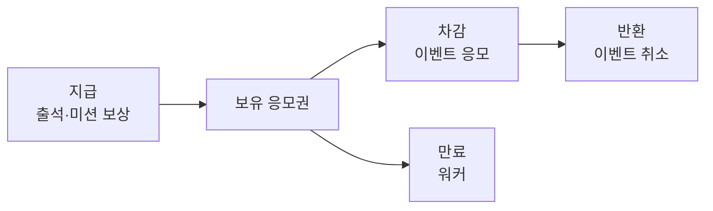

응모권 한 장이 DB의 한 행이고, 바뀔 때마다 이력이 한 줄씩 쌓입니다.

**설계·기술 선택과 사용 이유**

- 후보를 먼저 읽고 한 장씩 잠가서, 동시에 써도 어긋나지 않게 했습니다.
- 반환은 상태가 이상할 때만 이력을 잠그며 읽어서, 요청끼리 서로 맞물려 멈추는 일(교착)을 피했습니다.
- 만료는 다른 처리가 이미 잡고 있는 응모권을 건너뛰어(`SKIP LOCKED`), 서버가 여러 대여도 한 장을 두 번 만료하지 않습니다.

**문제와 해결 과정**

- 반환 이력을 항상 잠그며 읽었더니, 동시에 반환하는 요청들이 서로 맞물려 멈췄습니다(교착). 원인을 MySQL 교착 기록으로 확인하고, 상태가 이상할 때만 확인하도록 고쳤습니다.

**테스트 결과 (직접 측정)**

- 반환 이력 읽기: 대안은 60회 중 60회 교착, 채택한 방식은 0회.
- 만료 워커 4대: 약 3.5초 (대안은 20.9초).
- 내 노트북에서 한 상대 비교입니다.

자세한 표·시퀀스·측정 근거: [Wiki](https://github.com/Uplus-GETDDO/getddo-be/wiki/Mentoring-Domain-Flows#응모권)

</details>

<details>
<summary>이벤트 응모</summary>

<!-- 작성 담당: 윤태형 -->

**구현 기능·시연 흐름**

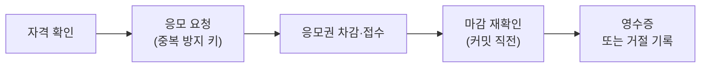

같은 키로 다시 보내면 처음 결과를 돌려주고, 거절도 기록해 두었다가 같은 오류를 돌려줍니다.

**설계·기술 선택과 사용 이유**

- 이벤트 행을 공유 잠금으로 읽어서 응모끼리 서로 기다리지 않게 했고, 마감은 차감 뒤와 커밋 직전에 두 번 확인합니다.
- 거절 기록은 응모가 취소돼도 남도록 별도 트랜잭션에 씁니다.

**문제와 해결 과정**

- 마감 직후에 커밋된 응모가 추첨 후보가 될 수 있었습니다. 커밋 직전 확인을 추가했고, 남는 아주 짧은 틈은 공용 명세에 예외로 승인했습니다.

**테스트 결과 (직접 측정)**

- 같은 이벤트에 64명이 동시 응모: 공유 잠금 102건/초, 쓰기 잠금 23건/초 (약 4.4배).
- 내 노트북에서 한 상대 비교입니다.

자세한 표·시퀀스·측정 근거: [Wiki](https://github.com/Uplus-GETDDO/getddo-be/wiki/Mentoring-Domain-Flows#이벤트-응모)

</details>

<details>
<summary>요청 빈도 제한</summary>

<!-- 작성 담당: 윤태형 -->

**구현 기능·시연 흐름**

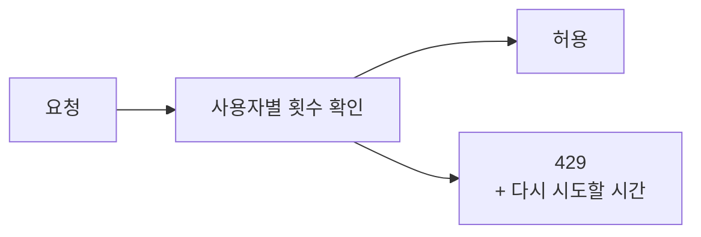

응모·출석·미션 제출·게임 결과 제출에 적용합니다. 거절은 DB 작업보다 먼저 일어납니다.

**설계·기술 선택과 사용 이유**

- 서버 메모리로만 세면 서버가 여러 대일 때 한도가 서버마다 따로 적용됩니다. 그래서 횟수 저장소를 바꿀 수 있게 만들었고, Redis 구현(PR #107, 10/16 병합)은 서버 여러 대의 횟수를 한곳에서 셉니다.

**문제와 해결 과정**

- 서버가 여러 대일 때 한도가 서버마다 따로 적용되는 한계를 Redis 구현으로 해결했습니다. 실제 서버에서 쓰려면 배포 설정 반영이 필요하고, 두 대 환경 실측은 아직 하지 않았습니다.

자세한 표·시퀀스: [Wiki](https://github.com/Uplus-GETDDO/getddo-be/wiki/Mentoring-Domain-Flows#요청-빈도-제한)

</details>

<details>
<summary>추첨·결과 공개</summary>

<!-- 작성 담당: 석종수 -->

> 단일 발표 요청 설명은 별도 [PR #108](https://github.com/Uplus-GETDDO/getddo-be/pull/108), `feat/GD-199`의 `65889fc` 구현을 포함한다. 작성 시점에는 미병합이며 아래 테스트 결과도 각 기준 코드를 따른다. 공용 추첨 정책은 [getddo-spec](https://github.com/Uplus-GETDDO/getddo-spec/blob/main/02-domain/drawing.md)을 원본으로 사용한다.

**구현 기능·시연 흐름**

| 항목 | 내용 |
| --- | --- |
| 하는 일 | 마감 5분 후 유효 응모와 실제 차감 이력을 대조해 후보·가중치·조건을 고정하고 추첨한다. 관리자는 결과를 검토하고, 필요하면 개별 당첨을 취소해 빈 자리만 재추첨한 뒤 전체 명단을 공개한다. |
| 관리자 API | 실행·후보 조회 `GET /admin/events/{eventId}/draws`, `GET /admin/draws/{drawId}`, `GET /admin/draws/{drawId}/participants` / 정합성 검사 `POST /admin/draws/{drawId}/checks` / 개별 취소 `POST /admin/wins/{winId}/cancellations` / 최초 발표 `POST /admin/draws/{runId}/result-confirmation` |
| 사용자 API | `GET /events/{eventId}/results` 공개 명단, `GET /events/{eventId}/my-result` 본인 결과. API 경로의 공통 접두사는 `/api/v1`이다. |
| 핵심 규칙 | 같은 실행의 확정 결과는 바뀌지 않는다. 이벤트 안에서 같은 사용자는 한 번만 당첨된다. 후보가 부족하면 상위 등수부터 배정하고 남은 자리는 미충원으로 기록한다. 자동 추첨 완료와 사용자 공개는 구분한다. |
| 시연 흐름 | 마감 후 자동 추첨 → 후보·가중치·경품별 결과 조회 → 정합성 검사 → 필요 시 개별 당첨 취소·재추첨 → 발표 요청 → 공개 명단·본인 결과 확인 → 같은 요청 재전송으로 결과·공개 중복이 없는지 확인 |

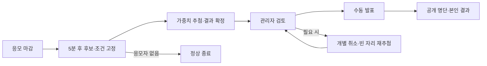

상세 호출·트랜잭션 흐름: [추첨·결과 공개 시퀀스 다이어그램 (Wiki)](https://github.com/Uplus-GETDDO/getddo-be/wiki/Mentoring-Drawing-Sequences)

**설계·기술 선택과 사용 이유**

- **가중치 비복원 추출**: 실제 차감한 응모권의 장수에 브론즈 1·실버 3·골드 5를 곱해 합산한다. 전체 가중치 범위에서 난수를 뽑고 누적 구간에 해당하는 후보를 선정한 뒤 제거한다. 같은 사용자가 다른 경품에서도 다시 당첨되는 것을 막는다. 가중치 미적용·응모권 미사용 이벤트는 후보별 가중치가 1이다.
- **보안 난수와 범위 검증**: `SecureRandom`으로 난수를 생성하고 범위를 벗어나면 다시 뽑는다. 전체 가중치는 `BigInteger`로 합산해 후보별 가중치 합계가 `long` 범위를 넘는 경우를 처리한다.
- **최초 후보와 실행별 명단 분리**: `draw_candidates`에는 최초 장수·가중치·응모 근거를 보존하고, `draw_run_candidates`로 각 실행에 포함된 후보를 연결한다. 재추첨마다 같은 상세 스냅샷을 복사하지 않으면서 당시 명단을 고정할 수 있다.
- **경품별 자리로 인원 검증**: `draw_results`는 경품의 자리마다 당첨 또는 미충원 한 행을 저장한다. 후보가 있는 최초 추첨은 결과 행 수가 전체 자리 수와 같고, 당첨 인원은 `min(후보 수, 자리 수)`여야 한다. 자리 누락·중복 당첨·후보가 남았는데 미충원되는 결과를 저장 전에 거절한다.
- **입력 준비와 결과 확정을 별도 트랜잭션으로 처리**: 실행 등록을 먼저 커밋하고 입력 준비·결과 확정을 나눈다. 선정이나 결과 저장이 실패해도 실행 ID와 이미 고정한 입력을 유지해 같은 실행을 재개할 수 있다.
- **이벤트 → 실행 잠금과 DB 제약**: 같은 이벤트의 확정을 직렬화하고, 실행별 자리·후보·선정 순서 UNIQUE와 후보 연결 복합 FK를 함께 사용한다. 응모의 이벤트 공유 잠금과 추첨의 쓰기 잠금이 연계되어 진행 중인 응모 처리를 기다린 뒤 후보를 읽는다.
- **확정 결과와 공개 명단 분리**: `draw_publications`와 `draw_publication_results`에 실제 공개 버전과 포함 결과를 보존한다. 유지 당첨자와 재추첨 당첨자를 한 명단으로 공개할 수 있고, 내부 변경이 사용자 명단에 바로 노출되지 않는다.

**문제와 해결 과정**

- **중복 요청으로 재선정될 위험** → 실행 ID와 상태를 기준으로 처리한다. `CONFIRMED`인 실행은 선정기를 다시 호출하지 않고 저장된 결과 ID·당첨 순서를 반환한다.
- **서버 중단 후 실행이 남는 문제** → 소유권 토큰과 만료 시각으로 실행 주체를 구분한다. 실패 이력·자동 재시도·운영자 재개를 같은 실행에 연결하고, 이전 시도의 뒤늦은 결과 저장을 막는다.
- **재추첨 결과를 기존 결과에 덮어쓰면 근거가 사라지는 문제** → 기존 결과는 유지하고 취소 이력과 새 실행을 추가한다. 취소 대상이 아닌 당첨자는 유지하며 최초 가중치로 빈 자리만 보충한다.
- **관리자가 검토한 명단과 발표 시점의 명단이 달라지는 문제** → 최신 실행 ID를 검사해 이전 명단의 발표를 거절한다. 동일 발표 재시도는 기존 성공 버전을 반환해 확인 기록·공개 버전·알림 작업을 중복 생성하지 않는다.
- **당첨자가 없는 재추첨은 공개 결과 연결만으로 확인 근거를 남길 수 없는 문제** → `draw_publication_executions`에 실행별 확인 근거를 별도로 저장한다. 모든 자리가 미충원이어도 해당 실행을 확인해 공개에 반영했다는 사실을 보존한다.
- **실제 응모와 추첨 준비의 마감 경합** → 서비스 통합 테스트로 커밋 직전 마감 검사 결함을 재현하고, 응모 담당자의 수정과 공용 명세의 승인된 마감 판정 예외를 반영해 검증했다.

**테스트 결과**

공통 실행 명령은 다음과 같다.

```bash
flock /tmp/getddo-docker-tests.lock ./gradlew test build \
  --init-script gradle/test-limits.init.gradle \
  --max-workers=1 --no-parallel
```

| 검증 | 실행 기록일 | 기준 코드 | 결과 |
| --- | --- | --- | --- |
| 실제 응모·차감 → 후보 스냅샷 | 2026-10-15 | [GD-131 `569d5af`](https://github.com/Uplus-GETDDO/getddo-be/pull/90) | 관련 MySQL 검증 17개 성공. 해당 코드의 전체 테스트·빌드 2,052개 성공 |
| 공개 명단·본인 결과 조회 | 2026-10-15 | [GD-140 `baf1fad`](https://github.com/Uplus-GETDDO/getddo-be/pull/93) | 관련 검증 26개 성공. 해당 코드의 전체 테스트·빌드 1,954개 성공 |
| 단일 발표·취소·재추첨·사용자 조회 | 2026-10-15~16 | [GD-199 구현본, 최종 설명 보완 `65889fc`](https://github.com/Uplus-GETDDO/getddo-be/pull/108) | 관련 MySQL 검증 39개 성공. 전체 테스트·빌드 2,215개 성공, 최종 커밋 CI 성공 |

- **알고리즘**: 제어 가능한 난수를 주입해 가중치 구간 경계, 상위 등수 우선 배정, 당첨 후보 제거, 후보 부족과 합계 범위 초과를 검증했다.
- **저장·동시성**: 실제 MySQL에서 이벤트 잠금 대기, 동시 확정 요청의 동일 결과 반환, 결과·상태 저장 실패 롤백과 UNIQUE·FK 제약을 검증했다.
- **정합성 검사**: 잘못된 장수·가중치, 중복 사용자·자리, 선정 순서 오류와 조기 미충원을 불일치로 판정하는지 검증했다.
- **공개**: 동일 발표 재시도, 이전 명단·미확정 실행의 발표 거절, 공개 트랜잭션 롤백과 공개 전 비노출·공개 후 마스킹을 검증했다.

각 전체 테스트 수는 서로 다른 기준 코드의 프로젝트 전체 집계이므로 합산하지 않는다. 위 결과는 기능·정합성 검증이며 이번 README 작성에서는 테스트를 재실행하지 않았다.

상세 구현: [후보·결과 저장](docs/03-database/drawing-selection-storage.md) · [관리자 조회·검증](docs/02-api/admin-draw-inspection.md) · [공개 저장](docs/03-database/draw-publication-storage.md) · [실패 복구](docs/06-runbook/draw-execution-recovery.md)

</details>

<details>
<summary>지급 전 어뷰징 차단 기록</summary>

<!-- 작성 담당: 석종수 -->

담당자 작성 예정입니다.

- **구현 기능·시연 흐름**: 작성 예정
- **설계·기술 선택과 사용 이유**: 작성 예정
- **문제와 해결 과정**: 작성 예정
- **테스트 결과**: 실행일·기준 커밋·명령·성공/실패·검증 범위 작성 예정

</details>

<details>
<summary>알림</summary>

<!-- 작성 담당: 전민규 -->

사이트 안에서 발생한 안내를 **사용자별 알림함에 저장하고, 실패한 처리는 시스템과 관리자가 이어서 복구**할 수 있도록 구현했습니다. 실제 문자·이메일·외부 푸시 대신 모의 발송을 사용합니다.

#### 구현 기능·시연 흐름

| 기능 | 구현한 내용 | 확인할 흐름 |
| --- | --- | --- |
| 내 알림함 | 커서 기반 목록·읽음 필터, 개별 읽음·전체 읽음 | 목록 조회 → 알림 클릭 → 읽음 처리. 조회만으로 읽음 상태를 바꾸지 않습니다. |
| 이벤트 시작 안내 | 시작 10분 전 현재 자격을 충족하는 활성 일반 사용자에게 작업 등록 | 워커 실행 → 수신자 확정 → 사용자별 알림 생성. 10분 전을 놓쳤더라도 시작 전이면 등록합니다. |
| 일정 변경·취소 안내 | 시작 알림을 이미 받은 사용자에게 별도 안내, 예전 시작 작업의 추가 생성 중지 | 이벤트 수정·취소와 작업 등록을 같은 트랜잭션으로 처리합니다. 기존 알림 내용·읽음 상태는 보존합니다. |
| 삭제된 이벤트 처리 | 기존 시작 작업의 추가 생성 중지 | 이벤트 논리 삭제와 함께 중지합니다. **별도 삭제 알림을 새로 보내지는 않습니다.** |
| 자동 재시도·관리자 복구 | 생성 실패와 모의 발송 실패를 각각 관리 | 최초 시도 + 최대 3회 자동 재시도 → 최종 실패 조회 → 관리자 복구 접수 → 워커 처리 순서입니다. |

알림 생성 작업은 `NotificationJobService`, 시작 시점 판정은 `EventStartNotificationService`, 변경·취소 안내는 `EventChangeNotificationService`가 담당합니다. 관리자에게는 작업 목록·상세, 사용자별 발송 이력, 생성·발송 복구 API를 제공합니다.

#### 설계·기술 선택과 사용 이유

| 선택 | 사용한 이유 |
| --- | --- |
| DB에 작업을 저장하고 스케줄러로 처리 | 원본 업무와 알림 작업을 함께 커밋하고, HTTP 요청이 전체 알림 생성을 기다리지 않도록 했습니다. 별도 메시지 브로커·Spring Batch는 추가하지 않았습니다. |
| 작업 발생 키와 `(job_id, user_id)` UNIQUE | 같은 발생 건의 재요청과 작업 도중의 재처리에서 중복 작업·중복 사용자 알림을 막습니다. 같은 키라도 입력이 다르면 충돌로 거절합니다. |
| 수신 대상 고정·사용자별 진행 위치 저장 | 중간 실패 후 대상이 바뀌거나 처음부터 복제되지 않도록 최초 대상과 이미 생성한 알림을 보존합니다. |
| 선점 만료 시각과 누적 처리 차수 | 다른 워커가 이어받을 수 있게 하고, 이전 워커가 늦게 도착한 결과로 새 결과를 덮어쓰지 못하게 합니다. |
| 읽음 상태와 발송 상태 분리 | 발송 성공과 사용자가 실제로 읽은 사실을 혼동하지 않습니다. 발송 복구로 읽음 상태를 바꾸지 않습니다. |

#### 문제와 해결 과정

- **일부 사용자에게만 생성된 뒤 실패하는 경우**: 사용자별 알림과 처리 위치를 함께 저장하고, UNIQUE 제약으로 재처리 시 기존 알림을 보존하도록 했습니다.
- **이벤트 일정이 바뀌었는데 예전 시작 안내가 계속 생성되는 경우**: 이벤트와 작업의 잠금 순서를 맞추고 중지 근거를 기록했습니다. 변경 안내 대상은 이미 시작 알림이 생성된 사용자로 고정합니다. 이벤트 수정·취소 서비스의 실제 호출 연결도 확인했습니다.
- **재시도 횟수가 소진된 작업을 관리자가 복구하는 경우**: V021에서 복구 구간의 시작 차수를 별도로 저장했습니다. 누적 차수는 유지하면서 새 구간에 최초 1회·자동 재시도 3회를 허용해 오래된 워커의 갱신을 계속 차단합니다.
- **다른 사람의 알림 ID로 읽음을 요청하는 경우**: 소유자 조건으로 갱신하고, 타인의 알림과 없는 알림을 동일한 부재 응답으로 처리합니다. 이미 읽은 본인 알림의 재요청은 허용합니다.

#### 테스트 결과

**실행 기준**: 2026-10-16 KST, 최신 확인 dev `88833cef`를 반영한 `docs/GD-212`의 코드 `2d2f1664`. Java 21·Testcontainers MySQL 8.4에서 담당 테스트만 필터링해 새로 실행했습니다.

| 검증 종류 | 실행 수 | 결과 |
| --- | ---: | --- |
| 알림 단위·MVC·매퍼 | 104 | 성공 |
| 알림 API·DB 통합 | 88 | 성공 |
| **알림 합계** | **192** | **실패·오류·건너뜀 0** |

- 수신 자격과 시작 10분 전 경계, 반복 폴링·동시 등록·부분 생성 뒤 재시도를 검증했습니다.
- 본인만 읽음 처리, 기존 알림 보존, 일정 변경·취소, 선점 만료·이전 워커 갱신 차단을 확인했습니다.
- 관리자 복구의 자격·새 재시도 구간·중복 복구 거절·감사 저장 실패 시 롤백을 검증했습니다.

<a id="gd212-owned-test-command"></a>

<details>
<summary>직접 실행한 담당 범위 테스트 명령</summary>

```bash
./gradlew \
  :core:test --tests 'com.getddo.core.notification.*' \
    --tests 'com.getddo.core.game.*' \
    --tests 'com.getddo.core.user.service.AdminUserQueryServiceTest' \
  :api:test --tests 'com.getddo.api.notification.*' --tests 'com.getddo.api.game.*' \
  :storage:db:test --tests 'com.getddo.db.notification.*' --tests 'com.getddo.db.game.*' \
  :api:integrationTest --tests 'com.getddo.api.notification.*' \
    --tests 'com.getddo.api.game.*' --tests 'com.getddo.api.user.AdminUserIntegrationTest' \
  :storage:db:integrationTest --tests 'com.getddo.db.notification.*' --tests 'com.getddo.db.game.*' \
  --rerun-tasks --init-script gradle/test-limits.init.gradle \
  --max-workers=1 --no-parallel --no-daemon --console=plain
```

</details>

위 명령 전체의 담당 범위 집계는 **354개 성공**이며, 알림 외에는 아래 게임·관리자 사용자 조회가 포함됩니다. 전체 프로젝트 테스트·빌드 성공을 뜻하지 않습니다.

실행 코드: [알림 서비스](core/src/main/java/com/getddo/core/notification/service) · [알림 API 통합 테스트](api/src/integrationTest/java/com/getddo/api/notification) · [알림 DB 통합 테스트](storage/db/src/integrationTest/java/com/getddo/db/notification). 처리 구조와 장애 확인은 [워커 운영 문서](docs/06-runbook/notification-worker.md)를 참고합니다. 해당 운영 문서의 과거 연결 대기 기록과 현재 서비스 코드는 기준 시점이 다르므로, 위 수행 내용은 이번 확인 코드와 실행 결과를 기준으로 합니다.

</details>

<details>
<summary>게임</summary>

<!-- 작성 담당: 전민규 -->

**클라이언트가 보낸 점수를 그대로 믿지 않고, 서버가 플레이 기록으로 점수를 판정한 뒤 통계와 일일 보상을 함께 확정**하도록 구현했습니다. 아래 결과 판정·보상 설명은 현재 구현된 **글자색깔 맞추기(`COLOR_WORD`)** 기준입니다. 다른 게임의 조회 노출과 서버 판정 지원 여부는 구분합니다.

#### 구현 기능·시연 흐름

| 단계 | 구현한 내용 | 사용자에게 보이는 결과 |
| --- | --- | --- |
| 1. 게임 선택 | 활성 게임 목록과 지원 게임 상세 조회 | 실제 DB 게임 ID·코드와 공개 규칙을 확인합니다. 미지원 상세는 별도 오류로 구분합니다. |
| 2. 플레이 시작 | 플레이 ID·토큰 발급, 당시 규칙과 생성 정보 보관 | 해당 플레이에 사용할 규칙·문제 생성 정보를 받습니다. |
| 3. 결과 제출 | 선택 답·순서·소요 시간·타임아웃 기록을 서버에서 재검증 | 서버가 계산한 `VALID/INVALID`와 확정 점수를 받습니다. 경합으로 처리 중이면 202를 반환합니다. |
| 4. 통계·보상 확정 | 최고점·누적점수·유효 횟수 갱신, 조건 충족 시 기존 지급 서비스 호출 | 유효 0점·보상 미달도 통계에 포함합니다. 50점 이상이면 사용자·게임·KST 날짜당 최대 1회 보상을 지급합니다. |
| 5. 내 통계 확인 | 오늘 보상 여부·다음 KST 자정·서버 시각 조회 | 게임이 비활성화돼도 본인의 과거 통계를 조회할 수 있습니다. |

보상은 기존 `TicketGrantService`를 재사용해 **등급 응모권 1장**을 지급합니다. 골드·실버·브론즈의 가중치를 실제 지급 장수로 바꾸지 않습니다. 같은 플레이의 결과를 다시 제출해도 통계와 보상을 다시 적립하지 않습니다.

#### 설계·기술 선택과 사용 이유

| 선택 | 사용한 이유 |
| --- | --- |
| 시작 당시 규칙·생성 버전·seed 보관 | 시작 후 설정이 바뀌어도 같은 문제와 기준으로 답안을 재현하고 서버 점수를 계산합니다. |
| 토큰 해시 저장·소유자 검증 | 원문 토큰을 저장하지 않고 플레이의 사용자·게임·토큰 조합을 확인합니다. 없는 플레이·타인 플레이·다른 게임·잘못된 토큰은 같은 404로 숨깁니다. |
| 결과 입력 해시와 최초 확정 결과 보관 | 같은 기록의 재요청에는 확정 결과를 돌려주고, 완료 후 기록을 바꾸면 409로 거절합니다. |
| 결과·통계·청구·지급을 하나의 트랜잭션으로 처리 | 점수만 저장되거나 보상만 지급되는 부분 성공을 막습니다. 실제 지갑·원장 처리는 응모권 담당 서비스에 위임합니다. |
| 사용자별 게임 통계 잠금과 일일 청구 UNIQUE | 서로 다른 플레이를 동시에 끝내도 같은 날짜의 보상이 중복 지급되지 않도록 합니다. |
| 공통 `TimeProvider`·요청 크기 제한 | KST 일자·다음 자정을 일관되게 계산하고, 결과 요청 1MiB·답변 10,000개 한도 및 기존 요청 제한을 적용합니다. |

#### 문제와 해결 과정

- **프론트 점수만 전송하면 판정 근거가 없는 문제**: 답변 기록을 서버 규칙으로 재생하고 정답 수·목숨·제한 시간·자연 종료 여부를 검사하도록 바꿨습니다. 정상 오답·시간 초과와 규칙을 어긴 무효 기록을 구분합니다.
- **동시 제출·네트워크 재시도로 통계나 보상이 늘어나는 문제**: 플레이 행 잠금, 최초 결과 고정, 일일 청구 제약을 조합했습니다. 같은 결과에는 기존 지급 내역을 돌려줍니다.
- **이미 실패한 트랜잭션 안에서 재시도하는 문제**: 바깥 결과 서비스와 트랜잭션을 여는 기록 서비스를 분리했습니다. 잠금·중복 경합은 제한적으로 새 트랜잭션에서 다시 시도하고, 처리 중 응답과 실패를 구분합니다.
- **자정 이후 재요청으로 보상일이 달라지는 문제**: 최초 확정 시각으로 보상일을 고정하고 재요청은 원래 결과·지급 내역을 반환합니다. 조회 시 오늘 보상 여부는 현재 KST 날짜로 계산합니다.

#### 테스트 결과

**실행 기준**: 2026-10-16 KST, 최신 확인 dev `88833cef`를 반영한 `docs/GD-212`의 코드 `2d2f1664`. Java 21·Testcontainers MySQL 8.4에서 담당 테스트만 필터링해 새로 실행했습니다.

| 검증 종류 | 실행 수 | 결과 |
| --- | ---: | --- |
| 게임 단위·MVC·Entity | 97 | 성공 |
| 게임 API·DB 통합 | 30 | 성공 |
| **게임 합계** | **127** | **실패·오류·건너뜀 0** |

실행 명령은 위 [담당 범위 공통 명령](#gd212-owned-test-command)의 game 필터입니다.

- 문제 생성·규칙 스냅샷·정상 오답·시간 초과·잘못된 순서·미종료 기록의 서버 판정을 확인했습니다.
- 0점·40점의 통계 반영, 50점의 일일 지급, 동시 완료 시 통계 2회·지급 1회를 검증했습니다.
- 동일 결과 재시도·다른 입력 충돌·자정 이후 재요청·잠금 경합 202·용량 초과 413·요청 제한 429를 확인했습니다.
- 지급 실패 시 결과·통계·청구·응모권이 함께 롤백되고, 통계 조회가 타인 데이터와 섞이지 않는지 검증했습니다.

실행 코드: [게임 서비스](core/src/main/java/com/getddo/core/game/service) · [게임 API 통합 테스트](api/src/integrationTest/java/com/getddo/api/game) · [게임 DB 통합 테스트](storage/db/src/integrationTest/java/com/getddo/db/game). 요청·재시도 연결 방법은 [결과·보상·통계 연동 안내](docs/02-api/game-results.md)를 참고합니다. 새 게임 판정 계약 초안과 작업 중인 코드는 이 검증의 완료 범위에 포함하지 않습니다.

</details>

<details>
<summary>백오피스·배너</summary>

<!-- 작성 담당: 전민규 -->

운영자가 **사용자 자격을 확인하고, 실패 알림을 복구하고, 홈 배너의 연결 이벤트·노출 순서를 관리**할 수 있도록 구성했습니다. 사용자 조회·알림 운영은 아래 담당 범위 검증 기준 코드에 포함되며, **배너는 별도 [PR #110](https://github.com/Uplus-GETDDO/getddo-be/pull/110)의 코드와 테스트로 구분**합니다.

#### 구현 기능·시연 흐름

| 구분 | 구현한 내용 | 확인할 흐름 |
| --- | --- | --- |
| 관리자 사용자 조회 | 목록·상세, 이름 검색과 ID·역할·상태·멤버십 AND 필터 | 활성 관리자로 검색 → 기본 20명·최대 100명 페이지 → 대상 사용자 상세 확인 |
| 공개 정보 제한 | ID·이름·역할·상태·멤버십·생성/수정 시각만 응답 | 연락처 등 불필요한 정보 없이 운영상 자격을 확인합니다. 사용자 수정 기능과 구분합니다. |
| 알림 운영 | 생성 작업·발송 이력 조회, 최종 실패 복구 | 실패 원인 확인 → 복구 요청 → 202 접수 → 워커 처리. 상세 동작은 위 알림 항목과 같습니다. |
| 배너 관리 | 사용자 목록, 관리자 목록·등록·수정·삭제·순서 변경의 6개 API | 이벤트·이미지 키·자리를 지정 → 앞자리 삽입 시 기존 배너 이동 → 삭제 시 빈자리 당김 |
| 배너 노출 | 숨긴 항목 포함 최대 5개, 이벤트 ID로 연결 | 취소·삭제된 이벤트 또는 미연결 이전 배너는 사용자에게 숨기고 관리자 목록에는 보존합니다. |
| 감사 기록 | 관리자의 알림 복구·배너 변경을 공통 기록 서비스와 연결 | 처리자·대상·변경 정보를 업무와 함께 기록합니다. **공통 감사 조회 API는 제공하지 않습니다.** |

#### 설계·기술 선택과 사용 이유

| 선택 | 사용한 이유 |
| --- | --- |
| 기존 사용자 문맥·`UserMapper`·`PageResult.map()` 재사용 | 인증 문맥과 응답 형식을 맞추고 기존 사용자 저장 모델을 중복 구현하지 않습니다. |
| JPA Criteria API로 사용자 조건 조합 | 선택 검색 조건을 목록·전체 건수 조회에 동일하게 적용합니다. 검색 특수문자는 문자 그대로 처리하고 동일 생성 시각에도 정렬을 고정합니다. |
| 배너 `event_id` 연결과 기존 행 보존 | URL 문자열에서 이벤트를 추측하지 않습니다. V028에서 연결 컬럼을 선택값으로 추가해 이전 데이터·URL을 보존하고, 새 등록·수정에는 정상 이벤트 연결을 검증합니다. |
| 배너 목록 잠금과 순서 계산 분리 | 자리 조정 중 전체 목록을 기준으로 1~5 범위·중복 금지·최대 개수를 검사합니다. 현재 항목 전체가 일치하는 순서 변경만 받습니다. |
| DB에는 이미지 키, 응답에는 공개 이미지 주소 | 저장소 접근 주소를 사용자 응답과 분리하고 기존 이미지 공개 주소 설정을 재사용합니다. 이 구현은 이미지 업로드 자체를 추가하지 않습니다. |
| 서비스 트랜잭션과 공통 감사 저장 | 업무 저장과 감사 기록이 함께 성공하거나 롤백되도록 묶습니다. |

#### 문제와 해결 과정

- **필터별 목록과 전체 건수가 어긋나는 문제**: 동일 조건으로 두 쿼리를 만들고, 큰 페이지·범위 밖 페이지·특수문자 검색을 실제 MySQL에서 검증하도록 구성했습니다.
- **배너 다섯 자리가 찬 상태의 순서 교환 문제**: 임시 순번 0·6은 기존 CHECK 제약에 걸리므로 같은 트랜잭션에서 변경 행을 재배치합니다. ID·생성 시각·기존 URL을 보존하도록 했습니다.
- **취소 이벤트 배너와 기존 미연결 데이터 처리 문제**: 배너를 자동 삭제하지 않고 사용자 조회에서 숨깁니다. 관리자는 기존 항목을 확인하고 연결을 수정하거나 삭제할 수 있습니다.
- **순서 변경 후 생성 시각이 시간대만큼 달라지는 문제**: JDBC 시각을 UTC `LocalDateTime`으로 전달하고 반복 순서 변경 뒤 생성 시각이 유지되는 회귀 테스트를 추가했습니다.
- **감사 저장 실패 검증 문제**: 저장소 예외가 Spring 데이터 접근 예외로 변환되는 점을 반영해 원인·롤백을 함께 확인합니다. 단순히 모든 예외를 허용하도록 검증을 완화하지 않았습니다.

배너 자체 리뷰에서 확인한 **서로 다른 이벤트를 동시에 수정할 때의 잠금 순서**와 **기존 비연속 순번을 정규화할 때의 감사 기록 누락 가능성**은 이번 문서 작업에서 수정하지 않았습니다. 아래 테스트 성공이 해당 두 경우까지 검증했다는 뜻은 아닙니다.

#### 테스트 결과

**관리자 사용자 조회·알림 운영** — 2026-10-16 KST, `docs/GD-212`의 코드 `2d2f1664`에서 위 [담당 범위 공통 명령](#gd212-owned-test-command)으로 검증했습니다.

| 검증 범위 | 단위·MVC | MySQL 통합 | 결과 |
| --- | ---: | ---: | --- |
| 관리자 사용자 조회 | 12 | 23 | **35개 성공** |
| 관리자 알림 운영 | 28 | 12 | **40개 성공** |

실패·오류·건너뜀은 0개입니다. 관리자 알림 운영 수치는 위 알림 합계에 포함되는 하위 집계이며 중복 합산하지 않습니다. 사용자 조회는 권한, AND 필터, `%·_·!`의 문자 검색, 안정 정렬, 큰 페이지, 응답 7개 필드, UTC 시각과 조회 전후 데이터 불변을 확인했습니다.

**배너** — 2026-10-16 KST, [PR #110](https://github.com/Uplus-GETDDO/getddo-be/pull/110)의 코드 `28e4ed05`에서 별도로 새로 실행했습니다. 배너 기능은 위 dev 기준 코드에 포함되지 않습니다.

| 검증 종류 | 실행 수 | 결과 |
| --- | ---: | --- |
| 배너 입력·순서·서비스·이미지 주소 단위 | 41 | 성공 |
| 실제 배너 API·MySQL | 12 | 성공 |
| V027 → V028 기존 행 보존 이전 | 1 | 성공 |
| **배너 합계** | **54** | **실패·오류·건너뜀 0** |

다섯 자리 순서 교환·삽입·삭제 후 당김, 취소·삭제·미연결 항목 숨김, 권한·응답 필드·이미지 주소, 동시 등록의 최대 개수, 감사 실패 롤백, 반복 이동 후 UTC 시각 보존과 기존 행·URL·제약 보존을 확인했습니다.

<details>
<summary>직접 실행한 배너 테스트 명령</summary>

```bash
./gradlew \
  :core:test --tests 'com.getddo.core.banner.*' \
  :api:test --tests 'com.getddo.api.banner.*' \
  :api:integrationTest --tests 'com.getddo.api.banner.BannerApiIntegrationTest' \
  :storage:db:integrationTest --tests 'com.getddo.db.banner.BannerMigrationIntegrationTest' \
  --rerun-tasks --init-script gradle/test-limits.init.gradle \
  --max-workers=1 --no-parallel --no-daemon --console=plain
```

</details>

이 검증은 로컬의 담당 기능 테스트이며 실제 FE·이미지 저장소·운영 DB 연결을 검증한 결과로 확대하지 않습니다.

구현 안내: [관리자 사용자 조회](docs/02-api/admin-users.md). 배너 소스는 검증한 PR 기준 [서비스](https://github.com/Uplus-GETDDO/getddo-be/blob/28e4ed0570bdb50d9409539e3e3931b7dd663324/core/src/main/java/com/getddo/core/banner/service/BannerService.java) · [실제 API·MySQL 테스트](https://github.com/Uplus-GETDDO/getddo-be/blob/28e4ed0570bdb50d9409539e3e3931b7dd663324/api/src/integrationTest/java/com/getddo/api/banner/BannerApiIntegrationTest.java)를 참고합니다.

</details>

## 실행 방법

Docker Compose 실행에는 Docker가 필요합니다. 터미널에서 애플리케이션이나 Gradle 작업을 실행하려면 JDK 21도 준비합니다. Gradle은 저장소의 Wrapper를 사용합니다.

### Docker Compose

저장소 루트에서 `.env.example`을 `.env`로 복사하고 `DB_PASSWORD`, `MYSQL_ROOT_PASSWORD`에 각각 로컬 비밀번호를 입력합니다. DB 이름과 일반 계정은 예시의 `getddo`를 사용합니다. `.env`는 Git과 Docker 빌드 컨텍스트에서 제외됩니다.

```bash
docker compose up --build -d
```

앱은 `http://localhost:8080`, MySQL 8.4는 `localhost:3306`에서 접근할 수 있습니다. Compose는 `local` Spring 프로필을 활성화하고, `application-local.yaml`에 정의된 MySQL JDBC 연결에 DB 환경변수를 전달합니다. MySQL 데이터는 Compose 볼륨에 유지됩니다. 종료할 때는 `docker compose down`을 사용합니다.

앱 시작 시 Flyway가 `storage:db/src/main/resources/db/migration/<도메인>/`의 SQL을 버전 순서대로 적용합니다. 마이그레이션이 추가될 때마다 버전 번호와 개수가 바뀌어 PR끼리 이 문단에서 충돌하므로 여기에는 적지 않습니다. 현재 목록은 해당 디렉터리를, 각 버전이 추가한 테이블·인덱스와 API 대응은 [API·DB 대응](docs/03-database/api-schema-mapping.md)을 확인합니다. 초기 스키마(44개 테이블)는 가장 앞의 마이그레이션 묶음이 생성하며, 이벤트의 논리 삭제 시각, 출석 기준일·사용자별 하루 1회 UNIQUE와 외래 키는 각 테이블의 초기 생성 정의에 포함되어 있습니다. Docker Desktop을 WSL에서 사용하는 경우 WSL 연동을 활성화해야 합니다.

### 터미널

JDK 21을 준비하고 저장소 루트에서 실행합니다. 앱을 터미널에서 실행하려면 앞의 `.env` 준비 후 `docker compose up -d db`로 개발용 MySQL만 시작합니다. `bootRun`은 `.env`를 자동으로 읽지 않으므로 같은 DB 접속 정보를 환경변수로 지정합니다.

macOS / Linux / WSL:

```bash
export SPRING_PROFILES_ACTIVE=local
export DB_HOST=localhost DB_PORT=3306
export DB_NAME=getddo DB_USERNAME=getddo
export DB_PASSWORD='<.env에 설정한 DB_PASSWORD 값>'
./gradlew :api:bootRun
```

Windows PowerShell:

```powershell
$env:SPRING_PROFILES_ACTIVE = 'local'
$env:DB_HOST = 'localhost'
$env:DB_PORT = '3306'
$env:DB_NAME = 'getddo'
$env:DB_USERNAME = 'getddo'
$env:DB_PASSWORD = '<.env에 설정한 DB_PASSWORD 값>'
.\gradlew.bat :api:bootRun
```

DB 이름이나 계정을 바꿨다면 환경변수도 `.env`와 맞춥니다.

### 테스트와 CI

DB가 필요한 테스트는 Testcontainers가 실행하는 임시 MySQL 8.4를 사용합니다. 개발용 DB·`.env` 설정 없이 실행하며, 임의의 호스트 포트로 연결하고 테스트 종료 시 컨테이너를 정리합니다. H2는 사용하지 않습니다.

공통 설정은 `storage/db/src/testFixtures/java/com/getddo/db/support`에 있습니다. `MySqlTestContainers`는 호출마다 새 컨테이너를 만들고, `MySqlTestConfiguration`은 `@ServiceConnection`으로 Spring의 JDBC·Flyway 연결을 자동 설정합니다. Spring 테스트는 `test` 프로필을 사용하며 컨테이너 시작·종료는 Spring이 관리합니다. 이 설정은 통합 테스트에서만 사용하고 운영 실행 JAR에는 포함하지 않습니다.

API의 앱 기동·Swagger 테스트는 `api/src/integrationTest/java/com/getddo/api/support/ApiIntegrationTest.java`의 `@ApiIntegrationTest`를 사용해 동일한 Spring 컨텍스트와 MySQL 하나를 공유합니다. 공통 Entity 테스트는 테이블을 생성·삭제하는 별도 DB를 사용하고, 초기 SQL 테스트는 JUnit이 관리하는 별도 컨테이너의 빈 DB에서 실행합니다. 다른 모듈이나 서로 다른 Spring 컨텍스트까지 강제로 공유하지 않습니다.

통합 테스트 전에 Docker Desktop의 Linux 컨테이너 엔진을 실행합니다. WSL에서는 Settings → Resources → WSL Integration에서 사용하는 배포판을 켜고, `docker version`에 Client와 Server가 모두 표시되는지 확인합니다. 첫 실행에는 MySQL 이미지 다운로드가 필요합니다.

| 작업 | macOS / Linux / WSL | Windows PowerShell | Docker |
| --- | --- | --- | --- |
| DB 없는 테스트 | `./gradlew test` | `.\gradlew.bat test` | 불필요 |
| MySQL 통합 테스트 | `./gradlew integrationTest` | `.\gradlew.bat integrationTest` | 필요 |
| 초기 SQL·공통 Entity 검증 | `./gradlew :storage:db:integrationTest` | `.\gradlew.bat :storage:db:integrationTest` | 필요 |
| 앱 기동·Swagger 검증 | `./gradlew :api:integrationTest` | `.\gradlew.bat :api:integrationTest` | 필요 |
| 전체 빌드·테스트 | `./gradlew build` | `.\gradlew.bat build` | 필요 |
| 실행 JAR 패키징 | `./gradlew :api:bootJar` | `.\gradlew.bat :api:bootJar` | 불필요 |

초기 SQL 검증은 빈 MySQL에 Flyway 마이그레이션을 적용하고, 재실행 시 추가 적용이 없는지 확인합니다. Docker에 연결할 수 없으면 통합 테스트는 실패합니다.

GitHub Actions의 `빌드·테스트`는 러너의 Docker에서 같은 `./gradlew build`를 실행합니다. 별도 DB 비밀값 설정은 필요하지 않습니다. 실패한 테스트 보고서는 `test-reports` 아티팩트에서 확인할 수 있습니다.

`PR 제목 검사`는 [공용 PR 제목 규칙](https://github.com/Uplus-GETDDO/getddo-spec/blob/main/01-conventions/pull-request.md)에 맞는지 별도로 확인합니다. PR 생성·수정·커밋 추가 시 실행하며, 제목·본문만 수정하면 Gradle 빌드는 실행하지 않습니다. 제목 오류로 병합을 막으려면 main/dev Ruleset의 필수 상태 검사에 `PR 제목 검사`를 등록합니다.

<details>
<summary>기존 전체 테스트 실행 기록 (2026-10-16, dev 15f2d95c)</summary>

2026-10-16 KST, dev `15f2d95c` 기준으로 전체 `test build`를 실행해 **BUILD SUCCESSFUL**을 확인했습니다.

| 구분 | 실행 수 | 결과 |
| --- | ---: | --- |
| DB 없는 단위·MVC·설정 검증 | 1,195 | 실패·오류·건너뜀 0 |
| Testcontainers MySQL 통합 검증 | 1,009 | 실패·오류·건너뜀 0 |
| **합계** | **2,204** | **성공** |

실제 잠금·중복 처리·마감 경계·롤백·공개 버전과 API 계약을 검증합니다. [Wiki 테스트 결과](https://github.com/Uplus-GETDDO/getddo-be/wiki/Mentoring-Tests)에 실행 명령·모듈/기능별 결과·원본 JSON/CSV를 정리했습니다. 같은 날 S3Mock에서 확인한 객체 입출력 17개는 이 집계와 별도입니다.

이 결과는 로컬 기능 검증이며 부하 처리량·실제 AWS 배포·FE 전체 흐름·S3/CloudFront 연동 완료를 뜻하지 않습니다. 후속 작업의 원격 CI 상태와 실제 연동 검증은 별도로 확인합니다.

</details>
