# GETDDO Backend

GETDDO는 응모권을 모아 경품 이벤트에 참여하고 추첨 결과를 확인하는 **이벤트 응모 및 추첨 플랫폼**입니다.

### 목차

1. [프로젝트 개요](#프로젝트-개요)
2. [기술 스택](#기술-스택)
3. [프로젝트 팀 구성 및 역할](#프로젝트-팀-구성-및-역할)
4. [아키텍처와 패키지 구조](#아키텍처와-패키지-구조)
5. [ERD](#erd)
6. [프로젝트 수행 경과](#프로젝트-수행-경과)
7. [실행 방법](#실행-방법)

## 프로젝트 개요

### 서비스 소개와 기획 배경

커머스의 경품 이벤트는 사용자의 참여를 유도하는 동시에 응모권 지급·사용 이력과 추첨 결과에 대한 신뢰가 필요한 기능입니다. GETDDO는 이 과제를 주제로 출석·미션·게임에서 이벤트 참여와 운영자용 백오피스까지 이어지는 서비스를 개발합니다.

사용자가 보는 참여 화면뿐 아니라 중복 요청, 동시 응모, 응모권 반환, 추첨 근거 보존과 실패 복구를 함께 다룹니다. 기획의 기준은 [공용 요구사항](https://github.com/Uplus-GETDDO/getddo-spec/blob/main/00-requirements/README.md)입니다.

### 프로젝트 목표

| 목표 | 확인할 내용 |
| --- | --- |
| 참여형 이벤트 경험 | 활동으로 응모권을 얻고 이벤트 조회·응모·결과 확인으로 이어지는 사용자 흐름 |
| 응모권의 일관성 | 지급·차감·반환·만료 이력과 현재 응모권 상태의 일치 |
| 신뢰할 수 있는 응모·추첨 | 중복 접수·중복 당첨 방지와 후보·가중치·조건·확정 결과 보존 |
| 운영 가능한 서비스 | 관리자 이벤트·경품 관리, 취소 처리, 알림과 실패 재처리 |

### 주요 서비스 흐름

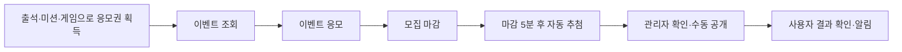

## 기술 스택

| 구분 | 기술 |
| --- | --- |
| 언어 |  |
| 프레임워크 |   |
| 빌드 |  |
| 데이터베이스 |  |
| 캐시 |  |
| 영속성·마이그레이션 |   |
| 객체 매핑 |   |
| API 문서 |   |
| 테스트 |    |
| 실행 환경 |   |
| CI |  |

## 프로젝트 팀 구성 및 역할

### 팀원 소개와 담당 영역

| 팀원 | 담당 영역 | 주요 기능 |
| --- | --- | --- |
| 이경주 | 인프라·공통 기반·사용자 | 실행·배포 환경, 공통 응답·오류·시간·감사 기록, 사용자·역할·멤버십 |
| 석종수 | 어뷰징 차단 기록·추첨 | 지급 전 차단 근거 기록, 후보·가중치 스냅샷, 추첨·당첨 취소·재추첨·결과 공개 |
| 전민규 | 백오피스·알림·게임 | 관리자 운영 기능, 배너·정책 관리, 알림 생성·발송·복구, 게임 검증·보상 자격 |
| 윤태형 | 응모권·미션·출석·응모 | 응모권 지급·차감·반환·만료, 출석·미션 보상, 응모 접수·내역 |
| 박지훈 | 이벤트·경품 관리·이벤트 취소 | 사용자·관리자 이벤트 조회, 이벤트·경품 CRUD, 시작·마감 전환, 취소 연동 |

## 아키텍처와 패키지 구조

### 시스템 아키텍처

[](docs/assets/cloud-architecture.drawio)

### 모듈 의존 관계

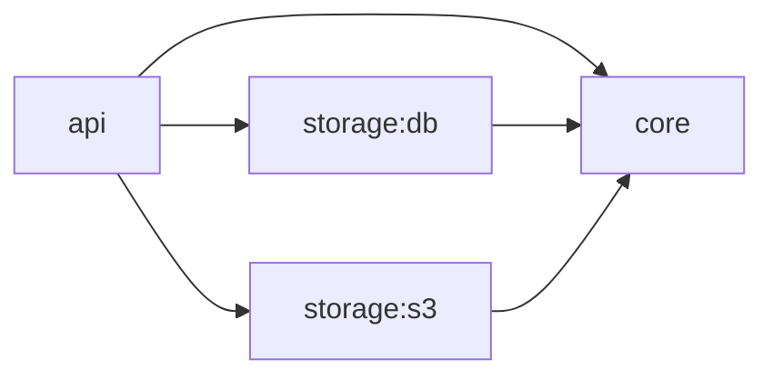

`api`만 실행 가능한 Spring Boot JAR을 만들고, `core`·`storage:db`·`storage:s3`는 라이브러리로 함께 실행합니다. `core`는 HTTP DTO와 JPA Entity에 의존하지 않고 Repository 인터페이스로 저장 기능을 사용합니다.

| 모듈 | 역할·사용 이유 |
| --- | --- |
| api | HTTP 요청·입력 검증·사용자 문맥·응답 변환을 업무 규칙과 분리 |
| core | 도메인 모델·업무 규칙·Service·트랜잭션과 Repository 계약을 관리 |
| storage:db | JPA·JDBC 저장 구현, Entity·Mapper와 Flyway 마이그레이션을 관리 |
| storage:s3 | 이벤트·경품 이미지의 S3 저장과 AWS SDK 설정을 업무 규칙에서 분리 |

### 패키지 구조

`<도메인>`은 `user`, `event`, `ticket` 등 기능별 패키지를 뜻합니다.

```text
getddo-be/
├── api/                                         # HTTP 요청·응답과 애플리케이션 실행
│   ├── build.gradle                             # 웹·검증·API 문서 의존성
│   └── src/
│       ├── main/
│       │   ├── java/com/getddo/api/
│       │   │   ├── GetddoBeApplication.java     # Spring Boot 진입점
│       │   │   ├── common/                      # API 공통 처리
│       │   │   │   ├── config/                  # MVC·CORS·OpenAPI 설정
│       │   │   │   ├── context/                 # 사용자 문맥 어노테이션·ArgumentResolver
│       │   │   │   ├── exception/               # 공통 API 오류 코드·전역 예외 처리
│       │   │   │   └── response/                # 공통 응답 형식 ResponseEnvelope
│       │   │   └── <도메인>/
│       │   │       ├── controller/              # 요청을 받아 Service에 위임
│       │   │       ├── dto/request/             # 요청 DTO와 입력 검증
│       │   │       └── dto/response/            # 응답 DTO·from(domain) 변환
│       │   └── resources/                       # application.yaml 등 실행 설정
│       ├── test/                                # DB 없는 API·설정 테스트
│       └── integrationTest/                     # 앱 기동·API·DB 연동 테스트
├── core/                                        # 도메인 모델과 비즈니스 규칙
│   ├── build.gradle                             # Spring Context·트랜잭션 의존성
│   └── src/
│       ├── main/java/com/getddo/core/
│       │   ├── common/                          # 공통 예외·페이지 조회 모델·시각 처리
│       │   └── <도메인>/
│       │       ├── domain/                      # 도메인 객체·상태·비즈니스 규칙
│       │       ├── service/                     # 업무 흐름과 트랜잭션
│       │       ├── repository/                  # 조회·저장 인터페이스
│       │       └── exception/                   # 도메인 오류 코드(ErrorCode 구현)
│       └── test/                                # 도메인 규칙·Service 테스트
├── storage/                                     # 영속성 모듈의 경로 구분
│   ├── s3/                                      # 이벤트·경품 이미지 S3 저장 어댑터
│   │   ├── build.gradle                         # AWS SDK 의존성
│   │   └── src/main/java/com/getddo/s3/event/    # S3 클라이언트 설정·저장 구현
│   └── db/                                      # MySQL 영속성 구현
│       ├── build.gradle                         # JPA·Flyway·MySQL 드라이버 의존성
│       └── src/
│           ├── main/
│           │   ├── java/com/getddo/db/
│           │   │   ├── common/                  # 공통 Entity·JPA Auditing 설정
│           │   │   └── <도메인>/
│           │   │       ├── entity/              # DB 테이블에 대응하는 JPA Entity
│           │   │       ├── repository/          # JpaRepository·core Repository 구현
│           │   │       └── mapper/              # Entity ↔ 도메인 객체 변환
│           │   └── resources/db/migration/      # 도메인별 Flyway SQL
│           ├── test/                            # DB 없는 영속성 관련 테스트
│           ├── integrationTest/                 # 실제 MySQL·마이그레이션 검증
│           └── testFixtures/                    # 공유 Testcontainers 설정
├── .github/                                     # GitHub 협업·자동화 설정
│   ├── pull_request_template.md                 # PR 작성 양식
│   └── workflows/                               # 빌드·테스트·이미지 생성·CD·PR 제목 검사
├── infra/                                       # 인프라 정의·배포 자동화 (Gradle 모듈과 별도)
│   └── scripts/                                 # 서버 배포·설정 조회 스크립트
│       ├── deploy-ssm.py                         # S3 파일 전달·SSM 배포 요청·결과 확인
│       ├── deploy-container.sh                   # 설정·컨테이너 교체와 실패 복구
│       ├── fetch-app-env.py                      # Parameter Store 설정 조회·검증
│       ├── daily-release.py                      # dev CI 확인·main 병합
│       └── publish-release.py                    # 배포 성공 버전 발행
├── docs/                                        # 백엔드 API·DB·결정·작업 기록
├── gradle/wrapper/                              # Gradle 실행 버전 고정
├── compose.yaml                                 # 로컬 앱·MySQL 컨테이너 구성
├── compose.deploy.yaml                          # 서버용 앱 컨테이너 구성
├── Dockerfile                                   # 애플리케이션 이미지 빌드
├── .env.example                                 # 로컬 환경변수 예시
├── build.gradle                                 # 모듈 공통 빌드·테스트 설정
├── settings.gradle                              # 프로젝트 이름·모듈 등록
├── gradlew                                      # macOS·Linux·WSL Gradle 실행
└── gradlew.bat                                  # Windows Gradle 실행
```

## ERD

[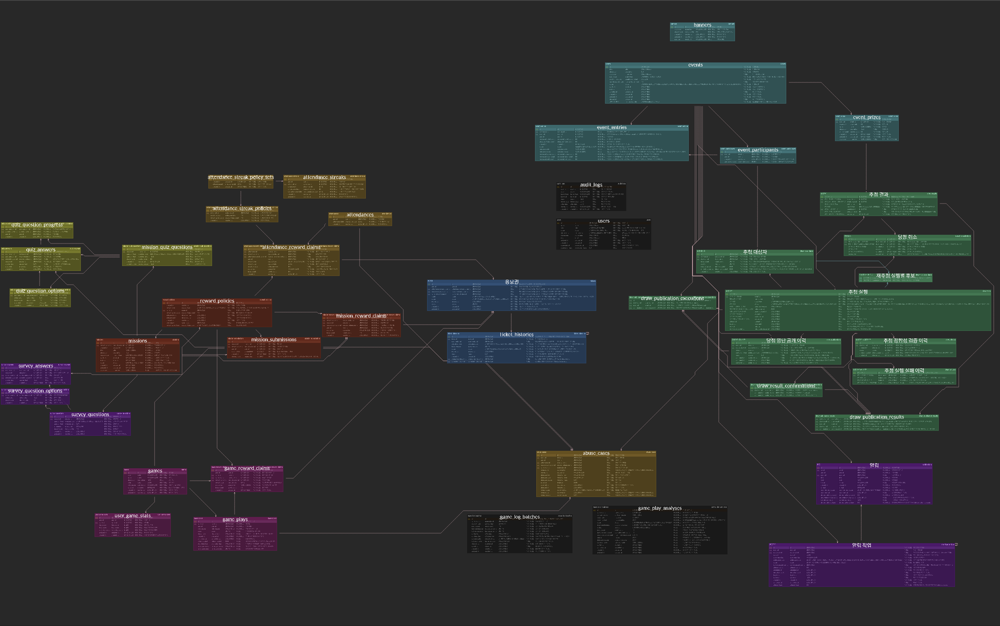](docs/assets/erd-2026-10-16.png)

[ERDCloud에서 확대·이동하며 보기](https://www.erdcloud.com/d/vuDvgmGQcvHf6f6g9) · [원본 이미지](docs/assets/erd-2026-10-16.png)

### 도메인별 ERD

| 도메인 | 테이블 수 | 내용 |
| --- | ---: | --- |
| [사용자](https://github.com/Uplus-GETDDO/getddo-be/wiki/ERD-user) | 1 | 사용자 정보·역할·멤버십 |
| [이벤트·응모](https://github.com/Uplus-GETDDO/getddo-be/wiki/ERD-event) | 5 | 이벤트·경품·응모자·응모 요청·배너 |
| [출석](https://github.com/Uplus-GETDDO/getddo-be/wiki/ERD-attendance) | 5 | 일일·연속 출석과 보상 청구 |
| [미션](https://github.com/Uplus-GETDDO/getddo-be/wiki/ERD-mission) | 10 | 퀴즈·설문·제출·보상 청구 |
| [게임](https://github.com/Uplus-GETDDO/getddo-be/wiki/ERD-game) | 6 | 게임·플레이·통계·보상·플레이 검증 근거 |
| [보상 정책](https://github.com/Uplus-GETDDO/getddo-be/wiki/ERD-reward) | 1 | 출석·미션·게임 보상 정책과 적용 기간 |
| [응모권](https://github.com/Uplus-GETDDO/getddo-be/wiki/ERD-ticket) | 2 | 응모권 한 장의 현재 상태와 처리 이력 |
| [어뷰징 검토](https://github.com/Uplus-GETDDO/getddo-be/wiki/ERD-abuse) | 1 | 응모권 지급 전 차단·탐지 근거 |
| [추첨·발표](https://github.com/Uplus-GETDDO/getddo-be/wiki/ERD-drawing) | 11 | 추첨 실행·후보·결과·확인·공개 버전과 실패 이력 |
| [알림](https://github.com/Uplus-GETDDO/getddo-be/wiki/ERD-notification) | 2 | 알림 생성 작업과 사용자 알림 |
| [감사 로그](https://github.com/Uplus-GETDDO/getddo-be/wiki/ERD-audit) | 1 | 변경 행위와 변경 전후 데이터 |

## 프로젝트 수행 경과

<details>
<summary>인프라·CI/CD</summary>

<!-- 작성 담당: 이경주 -->

#### 요청·데이터 흐름

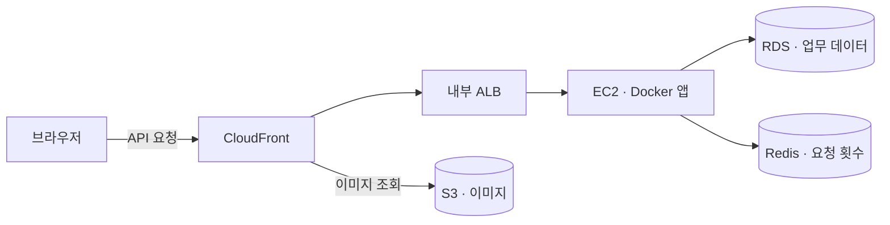

#### CI · 빌드와 이미지 생성

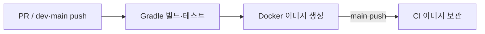

#### 정기 릴리스

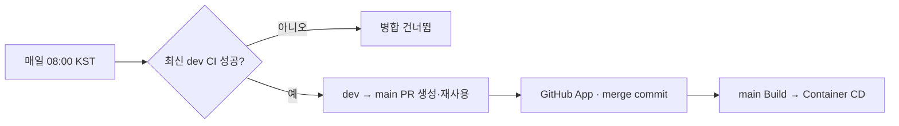

#### CD · 검증한 이미지 배포

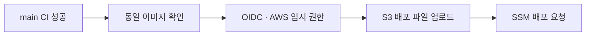

#### 서버 내부 · 설정 전달과 앱 교체

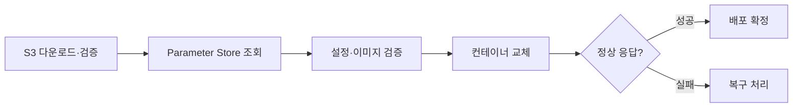

#### 배포 성공 후 버전 발행

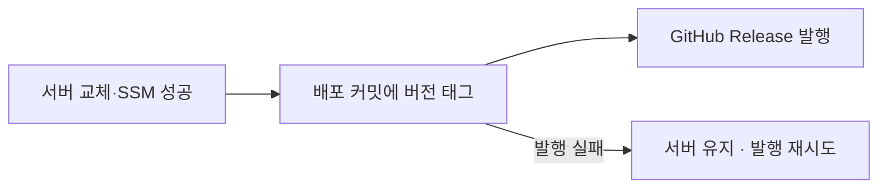

#### 실패 시 처리

| 실패 위치 | 처리 |
| --- | --- |
| dev·main CI | 정기 병합 또는 서버 배포를 진행하지 않음 |
| 설정 조회·이미지 검증 | 기존 앱·설정 유지 |
| 앱 교체·기동 확인 | 이전 설정·이미지 복구 시도 |
| 복구·기록 정리 | 백업·진행 기록 보존, 다음 배포 차단 후 수동 확인 |
| 태그·Release 발행 | 새 앱 유지, 서버를 롤백하지 않고 버전 발행 재시도 |

[배포 흐름·실패 대응 상세](https://github.com/Uplus-GETDDO/getddo-be/wiki/CI-CD-Release-Recovery)

#### 설계·기술 선택과 사용 이유

| 선택 | 정리할 내용 |
| --- | --- |
| Docker·Compose | CI 이미지 재사용·YAML 실행 설정 관리. Docker 운영과 서버별 배포 관리 부담을 수용. [대안·트레이드오프 비교](https://github.com/Uplus-GETDDO/getddo-be/wiki/Docker-Compose-Choice) |
| CloudFront·내부 ALB·보안 그룹 | HTTPS 진입, 요청 분산과 접근 경계 |
| RDS·ElastiCache·S3 | 업무 데이터·요청 횟수·이미지의 저장 목적 분리 |
| GitHub Actions·OIDC·SSM | 검증한 이미지 배포와 버전 발행을 분리합니다. 실패 단계별로 유지·복구·재시도를 구분합니다. [정기 릴리스·실패 대응](https://github.com/Uplus-GETDDO/getddo-be/wiki/CI-CD-Release-Recovery) |
| Parameter Store·IAM | 비밀값 보관과 서버별 접근 권한 |
| Terraform·IAM 정책 파일 | 리소스 정의와 변경 검토 방식 |

배포 코드: [CI](.github/workflows/build.yml) · [이미지 생성](.github/workflows/image.yml) · [CD](.github/workflows/cd.yml) · [서버 배포](infra/scripts/deploy-container.sh) · [정기 릴리스](https://github.com/Uplus-GETDDO/getddo-be/blob/6daa51196d24cce298d2824cdeae0ef883fa4408/.github/workflows/daily-release.yml)

</details>

<details>
<summary>공통 기반</summary>

<!-- 작성 담당: 이경주 -->

#### 공통 JSON 응답

성공·실패 모두 `success`, `code`, `message`, `data`로 응답합니다. `data`에는 API별 응답 DTO를 담습니다.

```java
public record ResponseEnvelope<T>(boolean success, String code, String message, T data) {}
```

**성공 응답 · 내 정보 조회 예시**

```json
{
  "success": true,
  "code": "SUCCESS",
  "message": "성공했습니다.",
  "data": {
    "id": "019a0000-0000-7000-8000-000000000001",
    "name": "시연 사용자",
    "role": "USER",
    "status": "ACTIVE",
    "membership": "vip",
    "phoneNum": null,
    "email": null
  }
}
```

**실패 응답 · 미등록 사용자, HTTP 401**

```json
{
  "success": false,
  "code": "USER-002",
  "message": "사용자를 확인할 수 없습니다.",
  "data": null
}
```

데이터 없는 성공 응답은 `ResponseEnvelope.success(null)`을 사용합니다. 오류의 HTTP 상태는 응답 본문과 별도로 지정합니다.

#### 공통 예외 처리

각 도메인은 `ErrorCode`를 구현해 상태·코드·메시지를 정의하고, 업무 오류를 `BusinessException`으로 전달합니다.

```java
throw new BusinessException(UserErrorCode.USER_NOT_FOUND);
```

`GlobalExceptionHandler`가 정의된 HTTP 상태와 `ResponseEnvelope.fail()` 응답으로 변환합니다. Controller마다 try-catch를 반복하지 않으며, 예외 원문·스택 트레이스는 응답에 넣지 않습니다.

#### 사용자 문맥과 Controller 재사용

```java
@GetMapping("/me")
public ResponseEnvelope<UserProfileResponse> getProfile(@CurrentUser User user) {
    return ResponseEnvelope.success(UserProfileResponse.from(userService.getProfile(user)));
}
```

`@CurrentUser`가 시연용 헤더의 형식과 DB 역할·멤버십을 대조해 사용자를 전달합니다. 같은 요청의 사용자 조회 결과를 재사용하고, 필요한 헤더는 Swagger에 자동 표시합니다.

#### 그 밖의 공통 기능

| 공통화한 기능 | 사용 방법·이유 |
| --- | --- |
| 시간 처리 | 주입받은 `TimeProvider`의 `now()`·`businessDate()`·`businessMonth()`로 UTC 시각과 KST 업무일을 계산합니다. 고정 `Clock`으로 날짜 경계 테스트도 재사용합니다. |
| Entity 식별자·감사 시각 | `BaseEntity`를 상속해 UUID v7·생성 시각을 사용하고, 수정 시각이 필요하면 `BaseUpdatableEntity`를 상속합니다. UUID는 `binary(16)`, JPA Auditing 시각은 마이크로초로 맞춥니다. |
| 업무 감사 기록 | 업무 트랜잭션 안에서 `AuditLogService.record(command)`를 호출합니다. `MANDATORY`로 업무와 함께 저장·롤백하고, `AuditLogCommand`는 변경 전후 데이터를 불변 스냅샷으로 보관합니다. |
| CORS 설정 | 허용 origin·메서드·헤더를 환경 설정으로 관리합니다. 공통 필터가 사전 요청과 실제 요청의 CORS 헤더를 처리합니다. |
| MySQL 테스트 기반 | `MySqlTestConfiguration`과 `@ApiIntegrationTest`로 MySQL 8.4 컨테이너·앱·MockMvc 설정을 재사용합니다. |

관련 코드: [응답 형식](api/src/main/java/com/getddo/api/common/response/ResponseEnvelope.java) · [전역 예외 처리](api/src/main/java/com/getddo/api/common/exception/GlobalExceptionHandler.java) · [사용자 문맥](api/src/main/java/com/getddo/api/common/context/CurrentUserArgumentResolver.java) · [시간 처리](core/src/main/java/com/getddo/core/common/time/TimeProvider.java) · [공통 Entity](storage/db/src/main/java/com/getddo/db/common/entity) · [감사 기록](core/src/main/java/com/getddo/core/audit) · [MySQL 테스트 설정](storage/db/src/testFixtures/java/com/getddo/db/support)

</details>

<details>
<summary>사용자</summary>

<!-- 작성 담당: 이경주 -->

담당자 작성 예정입니다.

- **구현 기능·시연 흐름**: 작성 예정
- **설계·기술 선택과 사용 이유**: 작성 예정
- **문제와 해결 과정**: 작성 예정
- **테스트 결과**: 실행일·기준 커밋·명령·성공/실패·검증 범위 작성 예정

기존 참고 자료: [Wiki](https://github.com/Uplus-GETDDO/getddo-be/wiki/Mentoring-Features#user) — 해당 문서의 기준 시점과 현재 구현을 확인한 뒤 작성합니다.

</details>

<details>
<summary>이벤트·경품 관리·이벤트 취소</summary>

<!-- 작성 담당: 박지훈 -->

**구현 기능·시연 흐름**

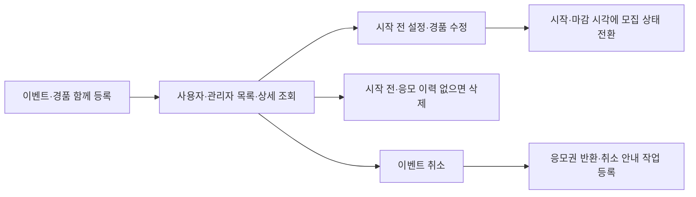

이벤트의 기간·멤버십·응모 조건과 등수별 경품·당첨 인원을 관리합니다. 실제 응모 접수·차감과 추첨·결과 공개는 각 기능과 연결합니다.

| 작업 | 처리 기준 |
| --- | --- |
| 등록·조회 | 이벤트와 경품을 함께 등록합니다. 관리자는 KST 날짜로 모집 기간이 겹치는 이벤트를 검색합니다. |
| 수정 | 시작 전 진행 예정 상태에서만 가능합니다. 시작 시각을 앞당길 수 없고, 기존 경품은 ID를 유지합니다. |
| 삭제 | 시작 전이고 응모 이력이 없을 때 `deleted_at`을 기록합니다. 이벤트·경품 행은 보존하고 목록·상세에서는 제외합니다. 배너는 관리자가 별도로 삭제합니다. |
| 취소 | 취소 상태·응모권 반환·취소 안내 작업·감사 기록을 함께 확정합니다. 이미 취소된 이벤트의 재요청은 409로 거절합니다. |
| 모집 상태 전환 | 전용 워커가 진행 예정 → 진행 중 → 마감을 처리합니다. 마감 +5분 자동 추첨과 관리자의 결과 공개는 별도 흐름입니다. |

**설계·기술 선택과 사용 이유**

- 조회는 JDBC로 검색·공개 상태 조건과 페이지 건수를 함께 다루고, 변경은 JPA와 이벤트 행 잠금으로 처리합니다. 잠금을 얻은 뒤 현재 시각을 다시 확인합니다.
- 이벤트·경품과 감사 기록, 취소와 반환을 같은 트랜잭션으로 묶어 "이벤트만 취소되고 응모권은 돌아오지 않는" 부분 처리를 막습니다. 알림은 작업 등록까지 함께 확정하고 실제 생성·발송은 워커가 처리합니다.
- 모집 상태 전환은 이벤트마다 따로 확정합니다. 이미 다른 처리가 잠근 이벤트는 건너뛰고(`SKIP LOCKED`), 한 이벤트가 실패해도 다음 이벤트를 처리합니다.

**문제와 해결 과정**

- 요청을 받을 때는 시작 전이어도 잠금을 기다리는 동안 이벤트가 시작될 수 있습니다. 잠금 획득 후 시각·상태를 다시 검사해 수정·삭제를 거절합니다.
- 1등과 2등 경품의 등수를 바로 교환하면 중간에 중복 등수가 생깁니다. 비어 있는 임시 등수를 거쳐 같은 트랜잭션에서 교환하고 기존 경품 ID를 유지합니다.
- 여러 이벤트를 한 번에 확정하면 하나의 감사 저장 실패가 전체 전환을 막을 수 있습니다. 이벤트별로 롤백하고 마지막으로 시도한 ID 다음부터 순환 조회하도록 나눴습니다.

**검증 결과**

- 2026-10-16 KST, dev `15f2d95c`에서 event 패키지 **255개**(단위·MVC·설정 131 / MySQL 통합 124)가 성공했습니다. 실패·오류·건너뜀은 0개입니다.
- 등록·조회·수정·삭제·취소 조건과 실제 MySQL의 잠금 경합·실패 롤백·워커 동시 처리를 검증했습니다. 이 수치는 기존 실행 기록이며 이번 문서 수정에서는 테스트를 재실행하지 않았습니다.

자세한 처리 흐름·설계 이유·테스트 근거: [Wiki](https://github.com/Uplus-GETDDO/getddo-be/wiki/Mentoring-Event-Flows)

</details>

<details>
<summary>출석</summary>

<!-- 작성 담당: 윤태형 -->

**구현 기능·시연 흐름**

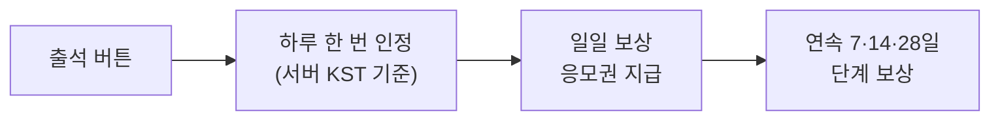

같은 날 다시 눌러도 보상은 한 번만 지급됩니다.

**설계·기술 선택과 사용 이유**

- 출석 기록, 보상 청구, 응모권 지급을 한 번에 확정해서 "출석은 됐는데 보상이 빠지는" 일이 없게 했습니다.
- 같은 날 동시에 눌러도 DB의 중복 방지(사용자 + 날짜)가 한 번만 처리되게 막습니다.

**문제와 해결 과정**

- 연타나 자정 직후 요청에서 보상이 두 번 나갈 수 있었습니다. DB 중복 방지를 마지막 방어선으로 두고, 충돌하면 한 번만 다시 처리해 먼저 확정된 결과를 돌려줍니다.

자세한 내용은 [Wiki](https://github.com/Uplus-GETDDO/getddo-be/wiki/Mentoring-Domain-Flows#출석)

</details>

<details>
<summary>미션</summary>

<!-- 작성 담당: 윤태형 -->

**구현 기능·시연 흐름**

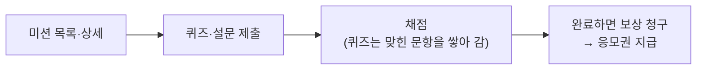

이미 완료한 미션은 다시 제출해도 보상이 더 나오지 않습니다.

**설계·기술 선택과 사용 이유**

- 제출 ID를 DB 기본키로 써서, 같은 요청이 동시에 와도 한 번만 처리됩니다.
- 재전송이 같은 요청인지는 처음 요청의 해시(요약값)로 구분합니다. 지급이 실패하면 제출·답변·청구가 모두 취소됩니다.

**문제와 해결 과정**

- 이미 맞힌 문항의 답은 저장하지 않아서, 재전송 내용을 저장된 답과 비교할 수 없었습니다. 처음 요청의 해시를 저장하도록 했습니다.

자세한 내용은 [Wiki](https://github.com/Uplus-GETDDO/getddo-be/wiki/Mentoring-Domain-Flows#미션)

</details>

<details>
<summary>응모권</summary>

<!-- 작성 담당: 윤태형 -->

**구현 기능·시연 흐름**

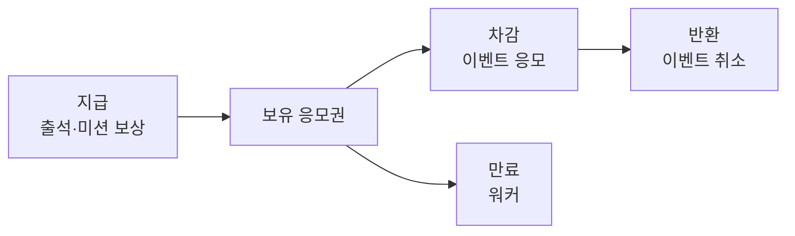

응모권 한 장이 DB의 한 행이고, 바뀔 때마다 이력이 한 줄씩 쌓입니다.

**설계·기술 선택과 사용 이유**

- 후보를 먼저 읽고 한 장씩 잠가서, 동시에 써도 어긋나지 않게 했습니다.
- 반환은 상태가 이상할 때만 이력을 잠그며 읽어서, 요청끼리 서로 맞물려 멈추는 일(교착)을 피했습니다.
- 만료는 다른 처리가 이미 잡고 있는 응모권을 건너뛰어(`SKIP LOCKED`), 서버가 여러 대여도 한 장을 두 번 만료하지 않습니다.

**문제와 해결 과정**

- 반환 이력을 항상 잠그며 읽었더니, 동시에 반환하는 요청들이 서로 맞물려 멈췄습니다(교착). 원인을 MySQL 교착 기록으로 확인하고, 상태가 이상할 때만 확인하도록 고쳤습니다.

**테스트 결과 (직접 측정)**

- 반환 이력 읽기: 대안은 60회 중 60회 교착, 채택한 방식은 0회입니다. 만료 워커 4대는 약 3.5초(대안 20.9초)입니다. 노트북 한 대에서 잰 상대 비교입니다.

자세한 내용은 [Wiki](https://github.com/Uplus-GETDDO/getddo-be/wiki/Mentoring-Domain-Flows#응모권)

</details>

<details>
<summary>이벤트 응모</summary>

<!-- 작성 담당: 윤태형 -->

**구현 기능·시연 흐름**

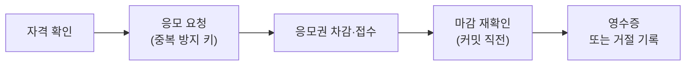

같은 키로 다시 보내면 처음 결과를 돌려주고, 거절도 기록해 두었다가 같은 오류를 돌려줍니다.

**설계·기술 선택과 사용 이유**

- 이벤트 행을 공유 잠금으로 읽어서 응모끼리 서로 기다리지 않게 했고, 마감은 차감 뒤와 커밋 직전에 두 번 확인합니다.
- 거절 기록은 응모가 취소돼도 남도록 별도 트랜잭션에 씁니다.

**문제와 해결 과정**

- 마감 직후에 커밋된 응모가 추첨 후보가 될 수 있었습니다. 커밋 직전 확인을 추가했고, 남는 아주 짧은 틈은 공용 명세에 예외로 승인했습니다.

**테스트 결과 (직접 측정)**

- 같은 이벤트에 64명이 동시에 응모하면 공유 잠금은 102건/초, 쓰기 잠금은 23건/초로 약 4.4배 차이가 납니다. 노트북 한 대에서 잰 상대 비교입니다.

자세한 내용은 [Wiki](https://github.com/Uplus-GETDDO/getddo-be/wiki/Mentoring-Domain-Flows#이벤트-응모)

</details>

<details>
<summary>요청 빈도 제한</summary>

<!-- 작성 담당: 윤태형 -->

**구현 기능·시연 흐름**

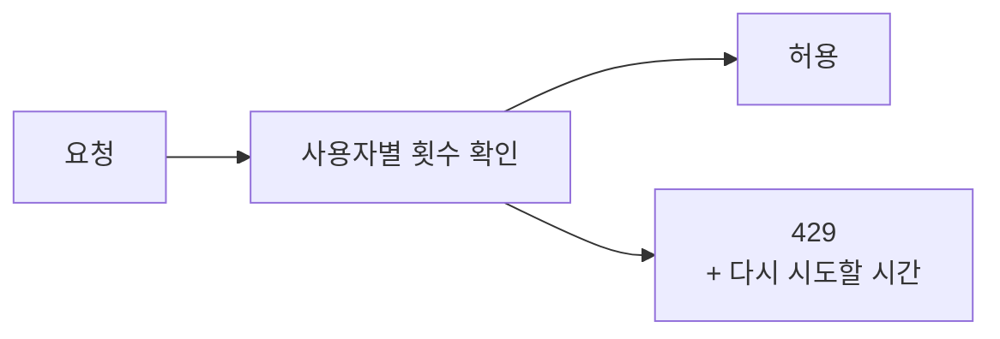

응모·출석·미션 제출·게임 결과 제출에 적용합니다. 거절은 DB 작업보다 먼저 일어납니다.

**설계·기술 선택과 사용 이유**

- 서버 메모리로만 세면 서버가 여러 대일 때 한도가 서버마다 따로 적용됩니다. 그래서 횟수 저장소를 바꿀 수 있게 만들었고, Redis 구현은 서버 여러 대의 횟수를 한곳에서 셉니다.

**문제와 해결 과정**

- 서버가 여러 대일 때 한도가 서버마다 따로 적용되는 한계를 Redis 구현으로 풀었습니다. 서버 두 대에서의 실측은 아직 하지 않았습니다.

자세한 내용은 [Wiki](https://github.com/Uplus-GETDDO/getddo-be/wiki/Mentoring-Domain-Flows#요청-빈도-제한)

</details>

<details>
<summary>추첨·결과 공개</summary>

<!-- 작성 담당: 석종수 -->

#### 전체 추첨 흐름

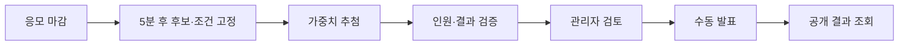

추첨은 자동으로 실행하고, 사용자에게 결과를 공개하는 시점은 관리자가 결정합니다. 확정된 결과는 같은 실행을 다시 요청해도 바뀌지 않습니다.

#### 후보·가중치 확정

성공한 응모와 실제 응모권 사용 이력을 대조해 후보를 구성합니다. 응모에 기록된 차감 수량, 실제 사용 이력 개수, 응모자 누적 사용량이 일치해야 합니다. 티켓 소유자와 중복 이력도 검사합니다.

```text
가중치 = 브론즈 사용 장수 × 1
       + 실버 사용 장수 × 3
       + 골드 사용 장수 × 5
```

골드·실버·브론즈를 한 장씩 사용하면 **후보는 1명, 실제 사용량은 3장, 가중치는 9**입니다. 가중치 미적용·응모권 미사용 이벤트는 후보별 가중치가 1입니다.

| 저장 위치 | 보존하는 내용 |
| --- | --- |
| `draw_candidates` — 최초 후보 스냅샷 | 실제 장수·가중치·응모 및 차감 근거 |
| `draw_run_candidates` — 실행별 후보 연결 | 해당 실행에 실제 포함한 후보 |
| `draw_runs.rules_snapshot` — 실행 조건 | 경품·등수·당첨 인원·가중치 기준 |

입력이 고정된 이후에는 현재 응모 데이터를 다시 계산하지 않고 저장된 스냅샷을 사용합니다.

#### 가중치 추첨

전체 가중치 범위에서 정수 난수를 뽑고, 누적 구간에 해당하는 후보를 선정합니다.

| 후보 | 가중치 | 난수 구간 | 첫 번째 선정 확률 |
| --- | ---: | --- | ---: |
| A | 1 | 0 | 1/9 |
| B | 3 | 1~3 | 3/9 |
| C | 5 | 4~8 | 5/9 |

난수가 6이면 C가 당첨됩니다. 이후 C를 후보에서 제거하고 전체 가중치에서도 5를 빼므로, 다음 선정은 A·B의 가중치 합계 4를 기준으로 진행합니다.

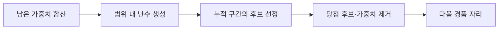

- 운영 난수는 `SecureRandom`을 사용하고, 범위 밖의 값은 다시 생성합니다.
- 전체 가중치는 `BigInteger`로 합산해 `long` 합계 범위 초과를 처리합니다.
- 상위 등수부터 선정하며 당첨자를 제거하므로 같은 사용자가 다른 경품에도 중복 당첨되지 않습니다.
- `개인 가중치 ÷ 남은 전체 가중치`는 각 선정 단계의 확률입니다.

#### 경품별 자리와 당첨 인원 검증

경품의 당첨 인원을 자리로 나누고, `draw_results`에 자리마다 `SELECTED` 또는 `UNFILLED` 결과를 저장합니다.

예를 들어 후보가 3명이고 경품 자리가 5개라면 다음과 같습니다.

| 경품 자리 | 결과 | 당첨자 |
| --- | --- | --- |
| 1등 1번 | SELECTED | A |
| 2등 1번 | SELECTED | B |
| 2등 2번 | SELECTED | C |
| 3등 1번 | UNFILLED | 없음 |
| 3등 2번 | UNFILLED | 없음 |

```text
결과 행 수 = 전체 경품 자리 수
당첨 인원 = min(후보 수, 전체 경품 자리 수)
미충원 수 = 전체 자리 수 - 당첨 인원
```

저장 전에는 자리 누락·중복, 후보에 없는 사용자, 사용자 중복, 선정 순서와 조기 미충원을 검사합니다. 응모자가 아예 없으면 `NO_ENTRIES`로 정상 종료하고 결과 행을 만들지 않습니다.

관리자 검사 API는 저장된 후보·조건·결과를 대조하고 `draw_checks`에 검사자·시각·항목별 결과를 추가합니다. 검사 과정에서 당첨자를 다시 뽑거나 기존 결과를 수정하지 않습니다.

#### 개별 당첨 취소·재추첨

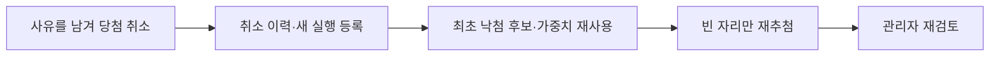

기존 결과를 삭제하거나 덮어쓰지 않고 `award_cancellations`에 취소 이력을 추가합니다. 최초 후보 중 기존 당첨자와 당첨 취소자를 제외하며, 취소 대상이 아닌 당첨자와 경품은 유지합니다.

재추첨은 최초 후보 상세를 복사하지 않고 새 실행에 연결합니다. 결과도 이번에 보충할 자리만 새 행으로 저장합니다.

#### 결과 확정과 공개

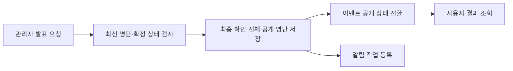

발표 요청 한 번으로 필요한 실행별 확인 기록, 전체 공개 명단, 이벤트 상태 변경과 알림 작업 등록을 같은 트랜잭션에서 처리합니다.

| 저장 위치 | 역할 |
| --- | --- |
| `draw_result_confirmations` — 결과 최종 확인 이력 | 실행별 확인자·확인 시각 |
| `draw_publications` — 공개 명단 버전 | 실제 발표자·공개 시각·버전 |
| `draw_publication_results` — 공개 결과 연결 | 유지 당첨자와 재추첨 당첨자를 합친 실제 명단 |
| `draw_publication_executions` — 공개 실행 확인 근거 | 당첨자가 없는 실행까지 포함한 확인 근거 |

사용자는 실제 공개 버전의 결과를 조회합니다. 공개 전에는 당첨 정보를 숨기고, 공개 명단에는 마스킹한 이름과 전화번호 끝 4자리를 제공합니다.

#### 중복 요청·실패 시 처리

| 상황 | 처리 |
| --- | --- |
| 같은 최초 추첨 등록 요청 | 기존 실행 재사용, 이벤트·차수 UNIQUE로 중복 등록 방지 |
| 이미 확정된 실행 재요청 | 저장된 결과 ID·당첨 순서 반환 |
| 결과 저장 중 실패 | 결과와 확정 상태를 함께 롤백, 등록된 실행 ID 유지 |
| 실행 중 서버 중단 | 소유권 만료와 실패·재시도 상태를 기준으로 같은 실행 복구 |
| 검토 후 명단 변경 | 이전 실행 ID의 발표 요청 거절 |
| 같은 성공 발표 재요청 | 기존 공개 버전 반환, 확인·공개·알림 작업 중복 생성 방지 |
| 공개 후 알림 처리 실패 | 알림 재시도로 처리하고 확정·공개 결과 유지 |

#### 설계·기술 선택과 사용 이유

| 선택 | 사용 이유 |
| --- | --- |
| 순수 선정기와 저장 서비스 분리 | DB 없이 가중치 구간과 선정 순서를 검증하고, API·워커가 같은 업무 로직 재사용 |
| 실행 등록·입력 준비·결과 확정 분리 | 중단·실패 후에도 실행 ID와 고정 입력을 유지 |
| 이벤트 → 실행 잠금 | 같은 이벤트의 동시 확정과 실행 간 배정 충돌 제어 |
| UNIQUE·복합 FK | 실행별 자리·후보·순서 중복과 잘못된 후보 연결 방지 |
| 불변 결과·별도 취소 이력 | 최초 선정부터 취소·재추첨까지 원래 근거 추적 |
| 공개 버전 분리 | 내부 변경과 실제 사용자 공개 명단 구분 |

#### 검증 결과

| 검증 범위 | 실행 기록일·관련 작업 | 결과 |
| --- | --- | --- |
| 실제 응모·차감과 후보 스냅샷 | 2026-10-15, GD-131 | 관련 MySQL 검증 17개 성공 |
| 공개 명단·본인 결과·마스킹 | 2026-10-15, GD-140 | 관련 검증 26개 성공 |
| 공개·취소·재추첨·사용자 조회 | 2026-10-15~16, GD-199 구현본 | 관련 MySQL 검증 39개 성공, 전체 테스트·빌드 2,215개 성공 |

가중치 구간 경계, 후보 부족, 잘못된 수량·가중치·자리, 실제 잠금 경합, 동시 확정과 저장 실패 롤백을 검증했습니다. 전체 테스트 수는 프로젝트 전체 집계이며 이번 README 수정에서는 테스트를 재실행하지 않았습니다.

[상세 시퀀스 다이어그램](https://github.com/Uplus-GETDDO/getddo-be/wiki/Mentoring-Drawing-Sequences)

</details>

<details>
<summary>지급 전 어뷰징 차단 기록</summary>

<!-- 작성 담당: 석종수 -->

담당자 작성 예정입니다.

- **구현 기능·시연 흐름**: 작성 예정
- **설계·기술 선택과 사용 이유**: 작성 예정
- **문제와 해결 과정**: 작성 예정
- **테스트 결과**: 실행일·기준 커밋·명령·성공/실패·검증 범위 작성 예정

</details>

<details>
<summary>알림</summary>

<!-- 작성 담당: 전민규 -->

#### 전체 알림 흐름

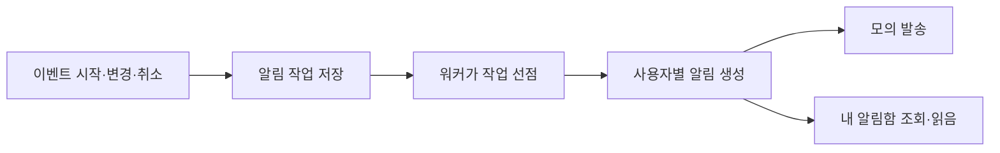

업무가 성공했을 때 알림 작업도 함께 저장하고, 실제 사용자별 알림 생성은 워커가 처리합니다. 사이트 내 알림함을 제공하며 외부 문자·이메일·푸시는 모의 발송으로 대체합니다. **발송 성공과 사용자가 읽은 상태는 별개**입니다.

#### 시작 알림과 수신 대상 확정

시작 10분 전부터 시작 직전 사이의 이벤트를 확인하고, 그 시점에 응모 자격을 충족하는 활성 일반 사용자를 수신자로 정합니다. 10분 전을 놓쳤더라도 시작 전이면 등록하며, 시작 시각이 지난 이벤트의 새 시작 작업은 등록하지 않습니다.

| 확인 항목 | 처리 |
| --- | --- |
| 이벤트 상태 | 삭제·취소되지 않은 진행 예정 이벤트만 선택 |
| 멤버십 | 이벤트의 최소 멤버십 이상인 활성 일반 사용자 선택 |
| 수신 대상 | 작업에 목록을 저장하고 이후 재시도에서도 같은 대상 유지 |
| 반복 폴링 | 발생 키로 기존 작업을 재사용하고 DB UNIQUE로 중복 등록 방지 |

예를 들어 수신자가 A·B·C이고 A·B의 알림만 만든 뒤 실패했다면, 재처리에서는 기존 두 알림을 유지하고 C의 알림을 이어서 만듭니다.

#### 일정 변경·취소·삭제

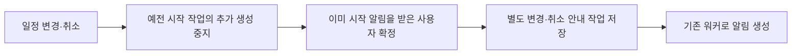

| 상황 | 처리 |
| --- | --- |
| 시작 안내를 아직 아무도 받지 않은 일정 변경 | 예전 작업의 생성을 중지하고 새 일정의 10분 전 구간에서 시작 안내 등록 |
| 일부 사용자에게 시작 안내가 생성된 뒤 일정 변경 | 남은 생성을 중지하고 이미 받은 사용자에게 별도 변경 안내 |
| 이벤트 취소 | 시작 작업의 추가 생성 중지, 이미 받은 사용자에게 취소 안내 |
| 이벤트 논리 삭제 | 시작 작업의 추가 생성만 중지. 별도 삭제 알림은 생성하지 않음 |

이벤트 변경·취소와 안내 작업 등록은 같은 트랜잭션으로 처리합니다. 이미 생성한 알림의 문구·읽음·발송 결과는 덮어쓰지 않습니다.

#### 실패 재시도와 관리자 복구

```mermaid
flowchart LR
    Attempt["생성·모의 발송 시도"] --> Check{"일시적 실패?"}
    Check -->|"예"| Retry["최대 3회 자동 재시도"]
    Check -->|"입력·제약 오류"| Failed["최종 실패 기록"]
    Retry -->|"모두 실패"| Failed
    Retry -->|"성공"| Done["처리 종료"]
    Failed --> Review["관리자 원인 확인·복구 접수"]
    Review --> NewCycle["새 복구 구간에서 워커 처리"]
```

생성과 모의 발송은 각각 **최초 1회 + 자동 재시도 최대 3회**를 적용합니다. 일시적 오류의 재시도 간격은 10초·30초·60초이며, 입력·제약 오류는 즉시 최종 실패로 기록합니다. 관리자 복구는 최종 실패 건만 대상으로 하며 정상 완료 건을 재발송하는 기능은 제공하지 않습니다.

#### 내 알림 조회와 읽음

커서 기반으로 본인 알림을 조회하고 읽음 여부로 필터링합니다. 목록 조회만으로는 읽음 처리하지 않으며, 개별 읽음·전체 읽음은 본인의 미읽음 알림만 변경합니다. 이미 읽은 본인 알림의 재요청은 같은 상태를 유지합니다.

#### 설계·기술 선택과 사용 이유

| 선택 | 사용 이유 |
| --- | --- |
| DB 작업 저장 + 스케줄러 | 업무와 작업을 함께 커밋하고 HTTP 요청에서 전체 알림 생성을 기다리지 않도록 처리 |
| 발생 키·사용자별 UNIQUE | 같은 발생 건과 같은 수신자의 알림이 재처리에서 중복 생성되는 상황 방지 |
| 수신 대상·진행 위치 보존 | 중간 실패 후 최초 대상과 이미 만든 알림을 유지하며 이어 처리 |
| 선점 만료·누적 처리 차수 | 중단된 워커의 작업을 이어받고 이전 워커의 늦은 결과 갱신 차단 |
| 읽음·발송 상태 분리 | 발송 성공이나 복구 요청이 사용자 읽음 상태를 바꾸지 않도록 관리 |

#### 중복 요청·실패 시 처리

| 상황 | 처리 |
| --- | --- |
| 같은 발생 키·같은 입력 | 기존 작업 ID 반환 |
| 같은 발생 키·다른 입력 | 충돌로 거절하고 기존 작업 보존 |
| 일부 사용자 알림 생성 뒤 실패 | 이미 생성한 알림 유지, 나머지 대상 이어 처리 |
| 작업을 다른 워커가 재선점 | 이전 처리 차수의 늦은 완료·실패 갱신 차단 |
| 관리자 복구 후 재시도 | V021의 복구 기준 차수로 새 시도 구간을 계산하며 누적 차수 유지 |
| 타인 알림 읽음 요청 | 없는 알림과 동일한 부재 응답으로 처리 |

#### 검증 결과

**실행 기준**: 2026-10-16 KST, 최신 확인 dev `88833cef`를 반영한 `docs/GD-212`의 코드 `2d2f1664`. Java 21·Testcontainers MySQL 8.4에서 담당 테스트만 필터링해 새로 실행했습니다.

| 검증 종류 | 실행 수 | 결과 |
| --- | ---: | --- |
| 알림 단위·MVC·매퍼 | 104 | 성공 |
| 알림 API·DB 통합 | 88 | 성공 |
| **알림 합계** | **192** | **실패·오류·건너뜀 0** |

- 수신 자격과 시작 10분 전 경계, 반복 폴링·동시 등록·부분 생성 뒤 재시도를 검증했습니다.
- 본인만 읽음 처리, 기존 알림 보존, 일정 변경·취소, 선점 만료·이전 워커 갱신 차단을 확인했습니다.
- 관리자 복구의 자격·새 재시도 구간·중복 복구 거절·감사 저장 실패 시 롤백을 검증했습니다.

<a id="gd212-owned-test-command"></a>

<details>
<summary>직접 실행한 담당 범위 테스트 명령</summary>

```bash
./gradlew \
  :core:test --tests 'com.getddo.core.notification.*' \
    --tests 'com.getddo.core.game.*' \
    --tests 'com.getddo.core.user.service.AdminUserQueryServiceTest' \
  :api:test --tests 'com.getddo.api.notification.*' --tests 'com.getddo.api.game.*' \
  :storage:db:test --tests 'com.getddo.db.notification.*' --tests 'com.getddo.db.game.*' \
  :api:integrationTest --tests 'com.getddo.api.notification.*' \
    --tests 'com.getddo.api.game.*' --tests 'com.getddo.api.user.AdminUserIntegrationTest' \
  :storage:db:integrationTest --tests 'com.getddo.db.notification.*' --tests 'com.getddo.db.game.*' \
  --rerun-tasks --init-script gradle/test-limits.init.gradle \
  --max-workers=1 --no-parallel --no-daemon --console=plain
```

</details>

위 명령 전체의 담당 범위 집계는 **354개 성공**이며, 알림 외에는 아래 게임·관리자 사용자 조회가 포함됩니다. 전체 프로젝트 테스트·빌드 성공을 뜻하지 않습니다.

실행 코드: [알림 서비스](core/src/main/java/com/getddo/core/notification/service) · [알림 API 통합 테스트](api/src/integrationTest/java/com/getddo/api/notification) · [알림 DB 통합 테스트](storage/db/src/integrationTest/java/com/getddo/db/notification). 처리 구조와 장애 확인은 [워커 운영 문서](docs/06-runbook/notification-worker.md)를 참고합니다. 해당 운영 문서의 과거 연결 대기 기록과 현재 서비스 코드는 기준 시점이 다르므로, 위 수행 내용은 이번 확인 코드와 실행 결과를 기준으로 합니다.

</details>

<details>
<summary>게임</summary>

<!-- 작성 담당: 전민규 -->

#### 게임 소개

게임별 대표 이미지와 플레이 방식입니다.

<!-- 이미지 원본: https://getddo-fe.vercel.app/images/games/{takoyaki-run,color-word,takko-timing}.jpg. 타꼬 주문은 FE cc1ea7bb의 public/images/games/takko-order.jpg(배포 주소 미반영). 원본 이미지를 수정 없이 보관한다. -->

| 타꼬런 | 글자색깔 맞추기 |
| :---: | :---: |
|  |  |
| 소스병과 꼬치를 점프로 피하며 달리는 게임입니다.<br>장애물을 피해 오래 버틸수록 점수가 올라갑니다. | 글자의 뜻에 속지 않고 글자에 칠해진 색을 고르는 게임입니다.<br>정답을 맞힐수록 제한 시간이 짧아집니다. |
| **타꼬 타이밍 맞추기** | **타꼬 주문** |
|  |  |
| 움직이는 이쑤시개를 타꼬에 맞춰 꽂는 게임입니다.<br>가운데에 정확히 맞추며 점수를 쌓습니다. | 손님의 주문을 기억하고 같은 순서로 메뉴를 내주는 게임입니다.<br>정답을 맞힐수록 기억해야 할 주문이 길어집니다. |

#### 전체 게임 처리 흐름

```mermaid
flowchart LR
    Select["게임 조회·선택"] --> Start["플레이 ID·토큰 발급"]
    Start --> Play["플레이·답변 기록"]
    Play --> Judge["서버 점수 판정"]
    Judge --> Save["결과·통계·보상 확정"]
    Save --> Result["결과·내 통계 조회"]
```

아래 서버 판정·보상 설명과 검증 기록은 **글자색깔 맞추기(`COLOR_WORD`)** 기준입니다. 게임 소개에 네 가지가 있다는 사실과 각 게임의 서버 판정·연동 완료 여부는 구분합니다.

#### 플레이 시작과 검증 기준 보관

플레이 시작 시 ID와 토큰을 발급하고, 그때의 규칙·생성 버전·seed를 저장합니다. 게임 설정이 나중에 바뀌어도 해당 플레이는 시작 당시 기준으로 판정합니다.

| 저장 정보 | 사용 목적 |
| --- | --- |
| 플레이 ID·사용자·게임 ID | 어떤 사용자가 어떤 게임을 시작했는지 확인 |
| 토큰 해시 | 원문 토큰을 저장하지 않고 결과 제출 자격 확인 |
| 규칙·생성 버전·seed | 같은 문제를 재현하고 당시 규칙으로 점수 계산 |
| 결과 입력 해시·완료 결과 | 재전송이 같은 기록인지 확인하고 최초 확정 결과 유지 |

#### 답변 기록과 서버 점수 판정

프론트에서 계산한 점수를 확정값으로 받지 않고 **선택 답·순서·소요 시간·타임아웃 기록**을 받아 서버가 문제를 재생합니다. 정답 수와 목숨, 제한 시간, 자연 종료 여부를 확인합니다.

정상적인 오답·시간 초과와 무효 기록을 구분합니다. 예를 들어 정상 종료한 0점은 유효한 결과로 통계에 포함하지만, 목숨이 남았는데 기록이 끝난 미종료 플레이는 같은 방식으로 인정하지 않습니다.

#### 결과·통계·일일 보상 확정

```mermaid
flowchart LR
    Valid["유효 결과"] --> Lock["사용자별 게임 통계 잠금"]
    Lock --> Score["결과·점수·통계 저장"]
    Score --> Eligible{"50점 이상·오늘 미지급?"}
    Eligible -->|"예"| Grant["일일 청구·응모권 지급"]
    Eligible -->|"아니오"| NoReward["추가 보상 없음"]
    Grant --> Commit["트랜잭션 커밋"]
    NoReward --> Commit
```

결과·통계·일일 청구와 실제 지급을 한 트랜잭션으로 처리합니다. 기존 `TicketGrantService`를 재사용해 등급 응모권 **1장**을 지급하며, 등급의 추첨 가중치를 실제 지급 장수로 바꾸지 않습니다.

| 예시 | 통계 | 보상 |
| --- | --- | --- |
| 정상 종료 0점·40점 | 유효 횟수·누적점수·최고점에 반영 | 없음 |
| 당일 첫 보상 조건 충족 50점 | 반영 | 응모권 1장 |
| 같은 날 다른 플레이로 다시 50점 | 새 플레이의 유효 통계는 반영 | 추가 지급 없음 |
| 이미 확정한 같은 결과 재전송 | 추가 반영 없음 | 최초 지급 결과 유지 |

보상일은 최초 유효 결과 확정 시각의 KST 날짜로 고정합니다. 내 통계에서는 현재 KST 날짜의 보상 여부와 다음 자정·서버 시각을 확인하며, 비활성화된 게임도 과거 통계 조회는 허용합니다.

#### 설계·기술 선택과 사용 이유

| 선택 | 사용 이유 |
| --- | --- |
| 시작 스냅샷과 서버 재계산 | 프론트 점수에 의존하지 않고 해당 플레이의 문제·규칙으로 판정 |
| 최초 결과·입력 해시 보존 | 같은 결과 재전송과 완료 후 기록 변경을 구분 |
| 결과·통계·청구·지급의 동일 트랜잭션 | 점수만 저장되거나 보상만 지급되는 부분 성공 방지 |
| 통계 행 잠금·일일 청구 UNIQUE | 서로 다른 플레이의 동시 완료에서도 하루 보상 중복 방지 |
| 바깥 결과 서비스·기록 서비스 분리 | 실패한 트랜잭션 밖에서 제한적으로 새 트랜잭션 재시도 |
| 공통 TimeProvider | 완료일·KST 보상일·다음 자정을 같은 기준으로 계산 |

#### 중복 요청·실패 시 처리

| 상황 | 처리 |
| --- | --- |
| 없는 플레이·타인 플레이·게임 불일치·잘못된 토큰 | 같은 404로 처리해 타인의 플레이 존재를 숨김 |
| 같은 플레이·같은 완료 기록 | 최초 확정 결과 반환 |
| 완료 후 다른 기록 제출 | 409 충돌로 거절 |
| 플레이 잠금 경합으로 처리 중 | 202 반환, 같은 플레이·기록으로 재요청 |
| 지급 중 실패 | 결과·통계·청구·지급 모두 롤백 |
| 자정 이후 같은 결과 재전송 | 최초 결과·보상일 유지 |
| 요청 1MiB·답변 10,000개 한도 초과 | 413으로 거절 |

#### 검증 결과

**실행 기준**: 2026-10-16 KST, 최신 확인 dev `88833cef`를 반영한 `docs/GD-212`의 코드 `2d2f1664`. Java 21·Testcontainers MySQL 8.4에서 담당 테스트만 필터링해 새로 실행했습니다.

| 검증 종류 | 실행 수 | 결과 |
| --- | ---: | --- |
| 게임 단위·MVC·Entity | 97 | 성공 |
| 게임 API·DB 통합 | 30 | 성공 |
| **게임 합계** | **127** | **실패·오류·건너뜀 0** |

실행 명령은 위 [담당 범위 공통 명령](#gd212-owned-test-command)의 game 필터입니다.

- 문제 생성·규칙 스냅샷·정상 오답·시간 초과·잘못된 순서·미종료 기록의 서버 판정을 확인했습니다.
- 0점·40점의 통계 반영, 50점의 일일 지급, 동시 완료 시 통계 2회·지급 1회를 검증했습니다.
- 동일 결과 재시도·다른 입력 충돌·자정 이후 재요청·잠금 경합 202·용량 초과 413·요청 제한 429를 확인했습니다.
- 지급 실패 시 결과·통계·청구·응모권이 함께 롤백되고, 통계 조회가 타인 데이터와 섞이지 않는지 검증했습니다.

실행 코드: [게임 서비스](core/src/main/java/com/getddo/core/game/service) · [게임 API 통합 테스트](api/src/integrationTest/java/com/getddo/api/game) · [게임 DB 통합 테스트](storage/db/src/integrationTest/java/com/getddo/db/game). 요청·재시도 연결 방법은 [결과·보상·통계 연동 안내](docs/02-api/game-results.md)를 참고합니다. 새 게임 판정 계약 초안과 작업 중인 코드는 이 검증의 완료 범위에 포함하지 않습니다.

</details>

<details>
<summary>백오피스·배너</summary>

<!-- 작성 담당: 전민규 -->

#### 전체 관리자 운영 흐름

```mermaid
flowchart LR
    Admin["활성 관리자 확인"] --> User["사용자 검색·상세 조회"]
    Admin --> Notification["실패 알림 조회·복구"]
    Admin --> Banner["배너 등록·수정·삭제·정렬"]
    Banner --> Save["배너 변경·감사 기록 함께 저장"]
    Save --> Display["사용자 화면 노출 조건 적용"]
```

사용자 자격 확인, 실패한 알림 처리 복구, 홈 배너 관리를 제공합니다. 알림 복구의 처리 방식은 위 알림 항목과 같습니다. 사용자 정보 수정과 공통 감사 조회 API는 제공하지 않습니다. 내부 감사 기록과 기존 감사 테이블·데이터는 유지하며, 개별 업무의 운영 내역 조회는 해당 업무 계약을 따릅니다.

#### 관리자 사용자 조회

이름 검색과 ID·역할·상태·멤버십 조건을 조합해 사용자를 찾고 상세 정보를 확인합니다. 기존 사용자 문맥과 저장소·Mapper를 재사용하며, 조회로 사용자 정보를 변경하지 않습니다.

| 항목 | 처리 |
| --- | --- |
| 접근 자격 | 활성 관리자만 목록·상세 조회 |
| 검색 조건 | 입력한 조건을 AND로 조합. 이름의 `%·_·!`는 문자 그대로 검색 |
| 페이지·정렬 | 기본 20명·최대 100명, 생성 시각·ID 내림차순으로 안정 정렬 |
| 공개 정보 | ID·이름·역할·상태·멤버십·생성/수정 시각의 7개 필드 |
| 제외 정보 | 연락처 등 조회 목적에 불필요한 정보 |

#### 배너 등록과 순서 관리

```mermaid
flowchart LR
    Input["이벤트·이미지 키·자리 입력"] --> Check["관리자·이벤트·최대 개수 확인"]
    Check --> Lock["배너 목록 잠금"]
    Lock --> Order["삽입·이동·삭제 순서 계산"]
    Order --> Save["배너·감사 기록 저장"]
```

숨긴 배너를 포함해 최대 5개를 관리하고, 노출 순서는 1~5 범위에서 유지합니다. 앞자리에 새 항목을 넣으면 기존 항목을 뒤로 옮기며, 삭제하면 빈자리를 당깁니다.

| 작업 예시 | 결과 순서 |
| --- | --- |
| 기존 목록 | A → B → C |
| 새 배너 D를 1번에 삽입 | D → A → B → C |
| 이후 B를 삭제 | D → A → C |

다섯 자리가 모두 차면 임시 순번 0·6도 기존 CHECK 제약에 걸립니다. 같은 트랜잭션에서 변경 행을 재배치해 순서를 맞추고 ID·생성 시각·기존 URL을 보존합니다.

#### 이벤트 연결과 사용자 노출

| 연결 상태 | 사용자 목록 | 관리자 목록 |
| --- | --- | --- |
| 노출 가능한 이벤트 연결 | 표시 | 표시 |
| 취소·논리 삭제된 이벤트 연결 | 숨김 | 보존 |
| 이벤트가 연결되지 않은 이전 배너 | 숨김 | 보존 |

V028에서 `event_id`를 선택값으로 추가해 이전 행·URL을 보존했습니다. 새 등록·수정에는 이벤트 연결을 검증하며, 기존 URL 문자열에서 이벤트 ID를 추측하지 않습니다. 이벤트 취소·삭제로 배너 행을 자동 삭제하지 않습니다.

#### 이미지 키와 공개 주소 분리

DB에는 이미지 키를 저장하고, 응답에서는 공개 이미지 주소 설정과 키를 조합해 사용자용 URL을 만듭니다.

```text
DB의 이미지 키 + 공개 주소 설정 → 응답의 imageUrl
```

이미지 저장소 접근 주소와 사용자용 주소를 분리합니다. 이 배너 구현 자체에 이미지 업로드 기능을 추가한 것은 아닙니다.

#### 설계·기술 선택과 사용 이유

| 선택 | 사용 이유 |
| --- | --- |
| 공통 사용자 문맥·UserMapper·PageResult.map 재사용 | 권한 확인·도메인 변환·페이지 응답의 공통 방식 유지 |
| JPA Criteria API | 선택 검색 조건을 목록과 전체 건수 조회에 동일하게 적용 |
| 배너 목록 잠금·순서 계산 분리 | 전체 개수·자리 중복·현재 항목 집합을 기준으로 변경 검증 |
| 기존 행 보존·명시적 이벤트 연결 | 이전 데이터를 지우거나 URL을 추정해 잘못 연결하는 상황 방지 |
| 업무와 감사 기록의 동일 트랜잭션 | 업무 변경과 관리자 처리 근거가 함께 성공하거나 롤백되도록 처리 |

#### 문제와 해결·검증 경계

| 상황 | 처리·확인 결과 |
| --- | --- |
| 검색 목록·전체 건수 불일치 | 같은 조건 생성 로직 적용, 큰 페이지·특수문자 검색 검증 |
| 다섯 자리의 순서 교환 | 기존 UNIQUE·CHECK를 지키는 행 재배치 적용 |
| 반복 정렬 후 생성 시각이 9시간 달라짐 | JDBC에 UTC LocalDateTime을 전달하도록 수정하고 회귀 검증 |
| 감사 저장 실패 | Spring 예외 변환의 실제 원인과 업무 롤백을 함께 검증 |
| 교차 이벤트 동시 수정의 잠금 순서 | 자체 리뷰 경계로 남아 있으며 아래 성공 집계의 검증 완료 대상이 아님 |
| 이전 비연속 순번 정규화의 감사 기록 누락 가능성 | 미해결 경계로 유지하며 정상 변경 감사 기록과 구분 |

#### 검증 결과

**관리자 사용자 조회·알림 운영** — 2026-10-16 KST, `docs/GD-212`의 코드 `2d2f1664`에서 위 [담당 범위 공통 명령](#gd212-owned-test-command)으로 검증했습니다.

| 검증 범위 | 단위·MVC | MySQL 통합 | 결과 |
| --- | ---: | ---: | --- |
| 관리자 사용자 조회 | 12 | 23 | **35개 성공** |
| 관리자 알림 운영 | 28 | 12 | **40개 성공** |

실패·오류·건너뜀은 0개입니다. 관리자 알림 운영 수치는 위 알림 합계에 포함되는 하위 집계이며 중복 합산하지 않습니다. 사용자 조회는 권한, AND 필터, `%·_·!`의 문자 검색, 안정 정렬, 큰 페이지, 응답 7개 필드, UTC 시각과 조회 전후 데이터 불변을 확인했습니다.

**배너** — 2026-10-16 KST, [PR #110](https://github.com/Uplus-GETDDO/getddo-be/pull/110)의 코드 `28e4ed05`에서 별도로 새로 실행했습니다. 배너 기능은 위 dev 기준 코드에 포함되지 않습니다.

| 검증 종류 | 실행 수 | 결과 |
| --- | ---: | --- |
| 배너 입력·순서·서비스·이미지 주소 단위 | 41 | 성공 |
| 실제 배너 API·MySQL | 12 | 성공 |
| V027 → V028 기존 행 보존 이전 | 1 | 성공 |
| **배너 합계** | **54** | **실패·오류·건너뜀 0** |

다섯 자리 순서 교환·삽입·삭제 후 당김, 취소·삭제·미연결 항목 숨김, 권한·응답 필드·이미지 주소, 동시 등록의 최대 개수, 감사 실패 롤백, 반복 이동 후 UTC 시각 보존과 기존 행·URL·제약 보존을 확인했습니다.

<details>
<summary>직접 실행한 배너 테스트 명령</summary>

```bash
./gradlew \
  :core:test --tests 'com.getddo.core.banner.*' \
  :api:test --tests 'com.getddo.api.banner.*' \
  :api:integrationTest --tests 'com.getddo.api.banner.BannerApiIntegrationTest' \
  :storage:db:integrationTest --tests 'com.getddo.db.banner.BannerMigrationIntegrationTest' \
  --rerun-tasks --init-script gradle/test-limits.init.gradle \
  --max-workers=1 --no-parallel --no-daemon --console=plain
```

</details>

이 검증은 로컬의 담당 기능 테스트이며 실제 FE·이미지 저장소·운영 DB 연결을 검증한 결과로 확대하지 않습니다.

구현 안내: [관리자 사용자 조회](docs/02-api/admin-users.md). 배너 소스는 검증한 PR 기준 [서비스](https://github.com/Uplus-GETDDO/getddo-be/blob/28e4ed0570bdb50d9409539e3e3931b7dd663324/core/src/main/java/com/getddo/core/banner/service/BannerService.java) · [실제 API·MySQL 테스트](https://github.com/Uplus-GETDDO/getddo-be/blob/28e4ed0570bdb50d9409539e3e3931b7dd663324/api/src/integrationTest/java/com/getddo/api/banner/BannerApiIntegrationTest.java)를 참고합니다.

</details>

## 실행 방법

Docker Compose 실행에는 Docker가 필요합니다. 터미널에서 애플리케이션이나 Gradle 작업을 실행하려면 JDK 21도 준비합니다. Gradle은 저장소의 Wrapper를 사용합니다.

### Docker Compose

저장소 루트에서 `.env.example`을 `.env`로 복사하고 `DB_PASSWORD`, `MYSQL_ROOT_PASSWORD`에 각각 로컬 비밀번호를 입력합니다. DB 이름과 일반 계정은 예시의 `getddo`를 사용합니다. `.env`는 Git과 Docker 빌드 컨텍스트에서 제외됩니다.

```bash
docker compose up --build -d
```

앱은 `http://localhost:8080`, MySQL 8.4는 `localhost:3306`에서 접근할 수 있습니다. Compose는 `local` Spring 프로필을 활성화하고, `application-local.yaml`에 정의된 MySQL JDBC 연결에 DB 환경변수를 전달합니다. MySQL 데이터는 Compose 볼륨에 유지됩니다. 종료할 때는 `docker compose down`을 사용합니다.

앱 시작 시 Flyway가 `storage:db/src/main/resources/db/migration/<도메인>/`의 SQL을 버전 순서대로 적용합니다. 마이그레이션이 추가될 때마다 버전 번호와 개수가 바뀌어 PR끼리 이 문단에서 충돌하므로 여기에는 적지 않습니다. 현재 목록은 해당 디렉터리를, 각 버전이 추가한 테이블·인덱스와 API 대응은 [API·DB 대응](docs/03-database/api-schema-mapping.md)을 확인합니다. 초기 스키마(44개 테이블)는 가장 앞의 마이그레이션 묶음이 생성하며, 이벤트의 논리 삭제 시각, 출석 기준일·사용자별 하루 1회 UNIQUE와 외래 키는 각 테이블의 초기 생성 정의에 포함되어 있습니다. Docker Desktop을 WSL에서 사용하는 경우 WSL 연동을 활성화해야 합니다.

### 터미널

JDK 21을 준비하고 저장소 루트에서 실행합니다. 앱을 터미널에서 실행하려면 앞의 `.env` 준비 후 `docker compose up -d db`로 개발용 MySQL만 시작합니다. `bootRun`은 `.env`를 자동으로 읽지 않으므로 같은 DB 접속 정보를 환경변수로 지정합니다.

macOS / Linux / WSL:

```bash
export SPRING_PROFILES_ACTIVE=local
export DB_HOST=localhost DB_PORT=3306
export DB_NAME=getddo DB_USERNAME=getddo
export DB_PASSWORD='<.env에 설정한 DB_PASSWORD 값>'
./gradlew :api:bootRun
```

Windows PowerShell:

```powershell
$env:SPRING_PROFILES_ACTIVE = 'local'
$env:DB_HOST = 'localhost'
$env:DB_PORT = '3306'
$env:DB_NAME = 'getddo'
$env:DB_USERNAME = 'getddo'
$env:DB_PASSWORD = '<.env에 설정한 DB_PASSWORD 값>'
.\gradlew.bat :api:bootRun
```

DB 이름이나 계정을 바꿨다면 환경변수도 `.env`와 맞춥니다.

### 테스트와 CI

DB가 필요한 테스트는 Testcontainers가 실행하는 임시 MySQL 8.4를 사용합니다. 개발용 DB·`.env` 설정 없이 실행하며, 임의의 호스트 포트로 연결하고 테스트 종료 시 컨테이너를 정리합니다. H2는 사용하지 않습니다.

공통 설정은 `storage/db/src/testFixtures/java/com/getddo/db/support`에 있습니다. `MySqlTestContainers`는 호출마다 새 컨테이너를 만들고, `MySqlTestConfiguration`은 `@ServiceConnection`으로 Spring의 JDBC·Flyway 연결을 자동 설정합니다. Spring 테스트는 `test` 프로필을 사용하며 컨테이너 시작·종료는 Spring이 관리합니다. 이 설정은 통합 테스트에서만 사용하고 운영 실행 JAR에는 포함하지 않습니다.

API의 앱 기동·Swagger 테스트는 `api/src/integrationTest/java/com/getddo/api/support/ApiIntegrationTest.java`의 `@ApiIntegrationTest`를 사용해 동일한 Spring 컨텍스트와 MySQL 하나를 공유합니다. 공통 Entity 테스트는 테이블을 생성·삭제하는 별도 DB를 사용하고, 초기 SQL 테스트는 JUnit이 관리하는 별도 컨테이너의 빈 DB에서 실행합니다. 다른 모듈이나 서로 다른 Spring 컨텍스트까지 강제로 공유하지 않습니다.

통합 테스트 전에 Docker Desktop의 Linux 컨테이너 엔진을 실행합니다. WSL에서는 Settings → Resources → WSL Integration에서 사용하는 배포판을 켜고, `docker version`에 Client와 Server가 모두 표시되는지 확인합니다. 첫 실행에는 MySQL 이미지 다운로드가 필요합니다.

| 작업 | macOS / Linux / WSL | Windows PowerShell | Docker |
| --- | --- | --- | --- |
| DB 없는 테스트 | `./gradlew test` | `.\gradlew.bat test` | 불필요 |
| MySQL 통합 테스트 | `./gradlew integrationTest` | `.\gradlew.bat integrationTest` | 필요 |
| 초기 SQL·공통 Entity 검증 | `./gradlew :storage:db:integrationTest` | `.\gradlew.bat :storage:db:integrationTest` | 필요 |
| 앱 기동·Swagger 검증 | `./gradlew :api:integrationTest` | `.\gradlew.bat :api:integrationTest` | 필요 |
| 전체 빌드·테스트 | `./gradlew build` | `.\gradlew.bat build` | 필요 |
| 실행 JAR 패키징 | `./gradlew :api:bootJar` | `.\gradlew.bat :api:bootJar` | 불필요 |

초기 SQL 검증은 빈 MySQL에 Flyway 마이그레이션을 적용하고, 재실행 시 추가 적용이 없는지 확인합니다. Docker에 연결할 수 없으면 통합 테스트는 실패합니다.

GitHub Actions의 `빌드·테스트`는 러너의 Docker에서 같은 `./gradlew build`를 실행합니다. 별도 DB 비밀값 설정은 필요하지 않습니다. 실패한 테스트 보고서는 `test-reports` 아티팩트에서 확인할 수 있습니다.

`PR 제목 검사`는 [공용 PR 제목 규칙](https://github.com/Uplus-GETDDO/getddo-spec/blob/main/01-conventions/pull-request.md)에 맞는지 별도로 확인합니다. PR 생성·수정·커밋 추가 시 실행하며, 제목·본문만 수정하면 Gradle 빌드는 실행하지 않습니다. 제목 오류로 병합을 막으려면 main/dev Ruleset의 필수 상태 검사에 `PR 제목 검사`를 등록합니다.
